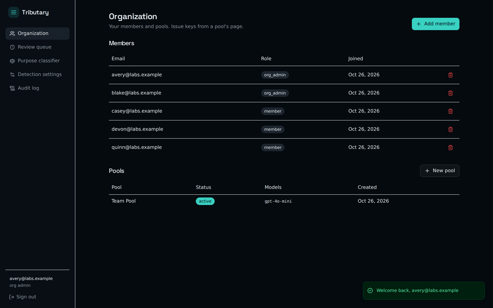

# Tributary

[](https://github.com/Phat1911/Tributary/actions/workflows/ci.yml)
[](https://github.com/Phat1911/Tributary/releases)
[](LICENSE)

**Governed AI capacity: your team shares one AI key, everyone gets their
own, and a pool's capacity can be prepaid and settled by a Solana
program.**

Solana is where the money side goes. A program has been live on devnet
since 1 November 2026. It holds a USDC escrow, takes and refunds renter
prepayments, records deposits as claims minted on the operator's word, and,
since 28 November, settles payouts: earnings become one Merkle root, a
depositor claims with a proof, and nothing pays before a challenge window.
A root, a paid claim, a challenge by an outside key, the multisig's ruling
and a depositor's own claim are on devnet, linked below. The
escrow holds devnet USDC only, and nothing in the product funds it yet. The
rest runs on your own machine:
Tributary is also a self-hosted gateway for teams that share AI capacity.
Each member gets a personal key. Every request is metered and checked
before it reaches the provider. Every admin action that changes state lands
in an append-only audit log. Depositors put spare keys and credits into a
pool; what their credits earn is kept in a double-entry ledger, to the
micro-unit. The software is free and source-available (FSL-1.1-ALv2, which
converts to Apache-2.0 after two years) and runs in one container.

**Landing page:** <https://tributary-landing-woad.vercel.app/>. There is no hosted
demo: run it locally with the Quickstart below.



## At a glance

- **A Solana program on devnet, governed by a 2-of-2 multisig** (2-of-3 is
  the planned production posture). A USDC escrow controlled by the program,
  renter prepayments and refunds, and deposits recorded as claims have been
  live since 1 November 2026. Since 28 November it also settles payouts:
  Merkle roots, claims with a proof, a challenge window, an operator bond.
  The upgrade that added them passed the 2-of-2 multisig; on devnet a claim
  has paid, an outside key's challenge has frozen a root, and the multisig
  has ruled. The program can be upgraded only by a multisig vote. See
  [What exists today](#what-exists-today).
- **Pool capacity earns for its supplier.** A pool of kind `root` accepts a
  supplier's credits: capacity its owner may serve others from, its own
  provider accounts or capacity it holds under an agreement. Each request's cost is metered to the micro-unit against the
  depositor whose credits burned, and posted to the books when the window
  is settled. A settle run pays each depositor what their credits earned,
  minus an 8% operator fee, once per window. No key or granted credit is
  ever shared or resold: a grant is used by the team it was given to.
- **Per-member keys over pooled capacity.** Quotas and rate limits run at
  the gateway before any upstream call. Provider keys are envelope-encrypted
  at rest and shown afterwards only as a prefix and a last four.
- **Governance that leaves a record.** Leak signals (for example one key
  seen from two networks) raise review flags. An audit log, enforced
  append-only by the database, records every control-plane action.
- **Tests before code, in public.** Security-critical features are written
  as failing tests first and then implemented to green. CI runs on every
  push to `main` and on every pull request. The security findings log,
  [`AUDIT.md`](AUDIT.md), is public.

## Why Solana

The off-chain part of Tributary, the gateway and its ledger, exists to
answer one question exactly: who earned what, to the micro-unit. The
on-chain part exists for the moment that answer turns into money between
people who do not trust each other.

- **Neither side should hold the books or the money.** An operator who runs
  the gateway controls its database, so it could alter what it owes. That is
  why the money and the payout records belong in a Solana program rather
  than in the operator's database. Today the escrow, the roots and the paid
  claims are all on devnet.
- **No single key can upgrade the program; a payout is a public event with
  a pause before it.** The escrow is a token account controlled by the
  program. A prepayment is signed by the paying key together with the
  operator's backend key; the paying key is normally the renter's own, and an
  operator may also fund a wallet-free renter this way (SPEC D44), a gap the
  audit tracks as A-043 until M10. A refund goes only to the renter who
  prepaid, up to that renter's on-chain record. Payouts have a different
  shape, stated plainly: the backend key alone can post a root naming any
  pubkey, up to the whole escrow, and open the assisted claim once the
  window has passed. What stands between that and a theft is the window
  itself: anyone can challenge the root within 100 slots, under a minute on
  devnet, and freeze its payouts, and only the 2-of-2 multisig can rule.
  Each has run on devnet, with a fresh unprivileged key of ours as the
  challenger: [a challenge by a key with
  no role](https://explorer.solana.com/tx/2GfqoxhMYdZkEH5q72zwWfVnDUCTvETmSHvsJFwT4PTMqREyPhVUkjrJXPx2PwNcuDywomihUWsysmu7VHELj4D6?cluster=devnet), [a claim refused while the root was
  frozen](https://explorer.solana.com/tx/5VhiGct8FVddSNy76HtA1yUUTnoA2ZtBhzzrUrZ7Peg54Lcma8bbg5SaUpsebfuQtMzHADgyVVcFftkvykjszFzd?cluster=devnet), [the ruling](https://explorer.solana.com/tx/Nwg7BhMMmJ2iHSF6xjMJ4WYPyzpP2xzWh9Keqj3zUfH1ZUB57ZfVgeDX6UsE2ZhTx4W6BYT8WWocT11s4ckwEih?cluster=devnet). Its vault is also the upgrade authority; the
  upgrade that put the settlement code in place, on 28 November, is
  [on-chain](https://explorer.solana.com/tx/37JFtEwYtSxHguzvGYjTv97vyMwR7ZSbyXddwFte6cgwjtwEcjn8r8CTsP6wTsCrZM4rm2v1mTEwZR5DvNeZ7KHN?cluster=devnet).
- **The chain does money; servers do speed.** No AI request ever routes
  on-chain. Metering, quotas and leak detection stay off-chain, where they
  are fast and keep usage data private; Solana carries only the money and
  its receipts.
- **Payouts are settled, not negotiated.** Earnings are merkleized into one
  root; a depositor claims with a proof; payouts wait for a challenge
  window; a root can never pay more than it declares (SPEC D45). These rules
  were written as twelve failing tests before any code existed. Since
  28 November the code is live on devnet: a root, a claim, a challenge, a
  freeze, a ruling and both claim doors have each run there.

### The program, precisely

Fifteen instructions, in `programs/pool/src/lib.rs` (the interface is
tracked as [`programs/pool/idl/pool.json`](programs/pool/idl/pool.json)),
each with its own tests in `programs/pool/tests`:

| Instruction | Who signs | What it does |
|---|---|---|
| `initialize` | the deployment authority (the multisig's vault) and a fee payer | creates the pool, its USDC escrow and a non-transferable claim mint, all program-derived accounts |
| `record_contribution` | the operator's backend key | mints claim records for a depositor: an attestation from the books. The chain checks the signer and the arithmetic, not a deposit's value |
| `burn_claims` | the depositor, or the backend key | burns a depositor's claim records |
| `prepay_renter` | the renter **and** the backend key | USDC into the escrow, recorded per renter |
| `refund_renter` | the renter, or the backend key; the program signs the transfer | USDC back to that renter only, capped by the renter's record |
| `pause`, `resume` | the admin authority, the multisig's vault | halt or restore every movement of funds |
| `set_backend_authority`, `set_admin_authority` | the admin authority | rotates the operator and admin keys |
| `fund_bond` | the backend key (the operator), which also pays | USDC from the operator's own wallet into a bond vault; the bond backs every root the operator posts |
| `post_root` | the backend key | records a window's Merkle root and its total, stamped with the slot; refuses a total above the escrow's balance, and a second root for the same window |
| `claim` | the depositor, or the backend key; a payer covers the claim marker's rent | checks the proof against the root, waits for the challenge window, pays the leaf's depositor from the escrow and adds the amount to the root's `paid_out` |
| `challenge` | any key | freezes a root's payouts until the multisig rules; only inside the challenge window |
| `resolve_challenge` | the admin authority, the multisig's vault | rules a challenged root: it stands (the rest of the window is waived), or it is false, with an exact slash and its victim recorded |
| `slash_bond` | no signer | executes a ruled slash from the bond vault to the recorded victim |

Three facts a reader should not have to dig for. The escrow holds **devnet
USDC only**; after the first paid claim it holds 0.050960, a renter's
unspent prepayment, and nothing in the product funds it for payouts yet
(the open earlier milestone, M10). A deposit on-chain is a claim record the
operator attests to: the chain verifies who signed, not what the deposit is
worth. And what a depositor has is a check on it: a payout root that can be
checked against the published payouts, and a challenge window before anything
is paid. Addresses and evidence: [What exists today](#what-exists-today).

## The problem it solves

Small teams share one AI key by pasting it into a group chat. Nobody can
tell who spent what. One heavy user can drain the quota. A leaked key is
discovered on the provider's invoice. The spare credit sitting on that key
earns nothing. Hosted API routers solve the first three problems by taking
your keys, your credits and your usage data. Tributary takes the other
road: the team keeps its own keys, on its own machine. It was built by a
student developer who kept running into exactly this trade.

When the people holding credits and the people needing them are strangers,
neither side should hold the money or the books. That is the part a
blockchain is for.

- **No middleman, no markup.** You pay provider prices directly.
- **Your keys and usage stay in the building by default.** One optional
  exception exists, and the organisation controls it: the purpose
  classifier is off by default and disclosed to members.
- **A router is something you rent; this is a building you own.**

**The other side of the same key.** AI capacity is expensive, and buying
it from anyone but the provider means paying first and trusting a stranger
to hold your money. Tributary's settlement layer is built for that
problem: a supplier runs a pool on its own provider accounts, so its keys
never leave it; buyers prepay into an escrow only the program can move;
at settle, the supplier is paid by rule. Where that stands on provider
terms is said plainly: no key or granted credit is ever shared or resold.
A granted credit is used by the team it was given to; a pool's supply is
its owner's own capacity; and serving buyers a supplier has never met
opens only behind the provider and reseller agreements that make it
lawful, which do not exist today. AI agents feel the problem most: an
agent is simply a member, with its own key and quota, calling the
OpenAI-compatible API without a wallet.

Self-hosted *and* a marketplace? The boundary: V1 is governance inside one
trust domain, with no blockchain, and your keys and usage data stay in your
building. The marketplace is opt-in, pool by pool: a supplier with capacity
of its own (a team, a lab, a company with committed spend) serves builders
and agents who prepay for it, at a pool price set by supply rather than
list price. That supply is never a grant: a hackathon or education credit
is used by the team it was given to, through that team's own gateway, and
never enters the market. Where strangers
exchange value, and nowhere else, the chain carries the receipts:
append-only books, an escrow that only the program's own instructions can
move, every money moment a public record. Credits bought at face value never enter that market; the
official provider is the right answer for those.

## Where to go next

| Document | What it covers |
|---|---|
| [`deploy/README.md`](deploy/README.md) | Ports, reverse proxies (the trusted-proxy setting matters), backups, Postgres, healthchecks, quota behaviour, upgrades |
| [`docs/threat-model.md`](docs/threat-model.md) | What is audited and how, what is **not** independently reviewed yet, bus factor |
| [`docs/onboarding-org-admin.md`](docs/onboarding-org-admin.md) | Admin first-day guide (draft): empty box → org → pool → member key → first request |
| [`docs/pilot-support.md`](docs/pilot-support.md) | "It broke" diagnostics: healthz → logs → audit → review queue |
| [`docs/founder-journey-settlement-screen.md`](docs/founder-journey-settlement-screen.md) | Depositor pools, the settle API and the settlement screen, end to end |
| [`docs/devnet-soak-m8.md`](docs/devnet-soak-m8.md) | The live devnet rehearsal: deploy, multisig hand-over, refused single-key upgrade, upgrade by 2-of-2 vote |
| [`docs/devnet-m11.md`](docs/devnet-m11.md) | Settlements on devnet: the 2-of-2 upgrade, a root posted, a claim paid, every signature linked |
| [`SPEC.md`](SPEC.md) · [`PLAN.md`](PLAN.md) · [`AUDIT.md`](AUDIT.md) | Rules and roadmap · status log · every finding |
| [`SECURITY.md`](SECURITY.md) · [`CONTRIBUTING.md`](CONTRIBUTING.md) | Private disclosure · conventions and dev setup |
| [Pilot feedback](https://github.com/Phat1911/Tributary/issues/new?template=pilot-feedback.yml) | Running a pilot? Tell us what worked and what broke |
| [`LICENSE`](LICENSE) | FSL-1.1-ALv2: each version converts to Apache-2.0 after two years |

## Repository layout

```
crates/            Rust workspace: gateway (OpenAI-compatible proxy, metering),
                   control (admin API, auth), ledger, crypto, common
apps/dashboard/    Next.js + TypeScript dashboard (pnpm workspace), baked into the image
programs/pool/     Solana program (Anchor): escrow vault, deposits, renter prepayment;
                   Merkle settlement (in progress)
migrations/        sqlx migrations, run on SQLite and Postgres
scripts/           demo seed, mock upstreams, OpenAI-SDK contract test, devnet soak tool
deploy/            Dockerfile, entrypoint, .env.example: single-container deployment
docker-compose.yml the Quickstart deployment (reads a gitignored .env)
landing/           the landing page, published on GitHub Pages
docs/              threat model, devnet soak report, founder journeys, operations
SPEC.md            product and design rules, decision log, roadmap
PLAN.md            status and milestone log
AUDIT.md           security and spec-conformance findings, with evidence
AGENTS.md          the working agreement for people and AI agents in this repo
```

## Developing and verification

Rust:

```sh
cargo fmt --all -- --check
cargo clippy --workspace --all-targets -- -D warnings
cargo test --workspace
```

Dashboard:

```sh
pnpm install
pnpm -C apps/dashboard build
```

Solana program (toolchain pinned in CI, Agave v4.1.2):

```sh
cd programs/pool && cargo-build-sbf --arch v3 && cd ../.. && cargo test -p pool
```

CI ([`.github/workflows/ci.yml`](.github/workflows/ci.yml)) runs five jobs
on every push to `main` and on every pull request: **rust** (fmt, clippy with warnings denied, the test suite on
SQLite and Postgres), **dashboard** (lint, typecheck, build), **e2e**
(Playwright journeys against a real stack), **sdk-contract** (the official
OpenAI SDKs against OpenAI- and Gemini-compatible upstreams) and **deny**
(cargo-deny).

## Author and license

Built by Tran Dinh Hong Phat (Hong Phat), a second-year IT student in Da
Nang, Vietnam. One maintainer builds Tributary today; the
[threat model](docs/threat-model.md) says so plainly.

Copyright 2026 Tran Dinh Hong Phat. Licensed under the
[Functional Source License, Version 1.1, ALv2 Future License](LICENSE)
(FSL-1.1-ALv2). Each version converts to Apache-2.0 two years after it is
made available.
