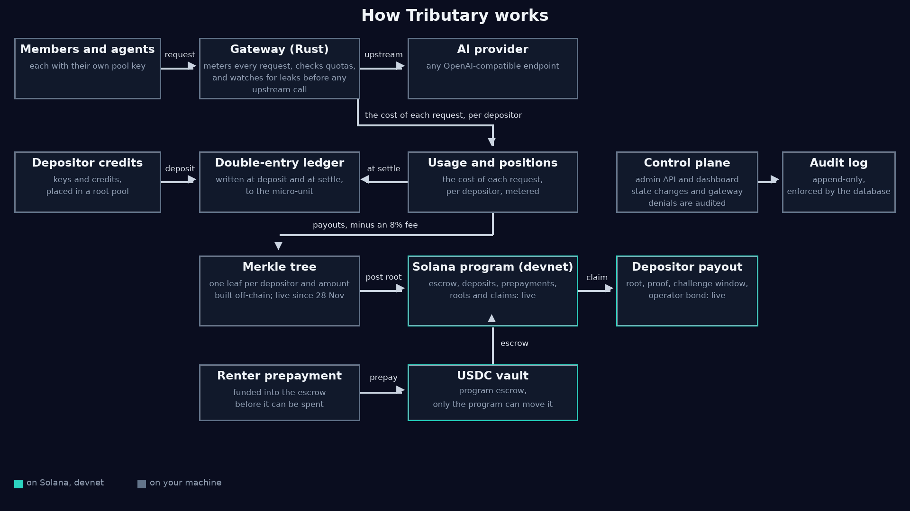
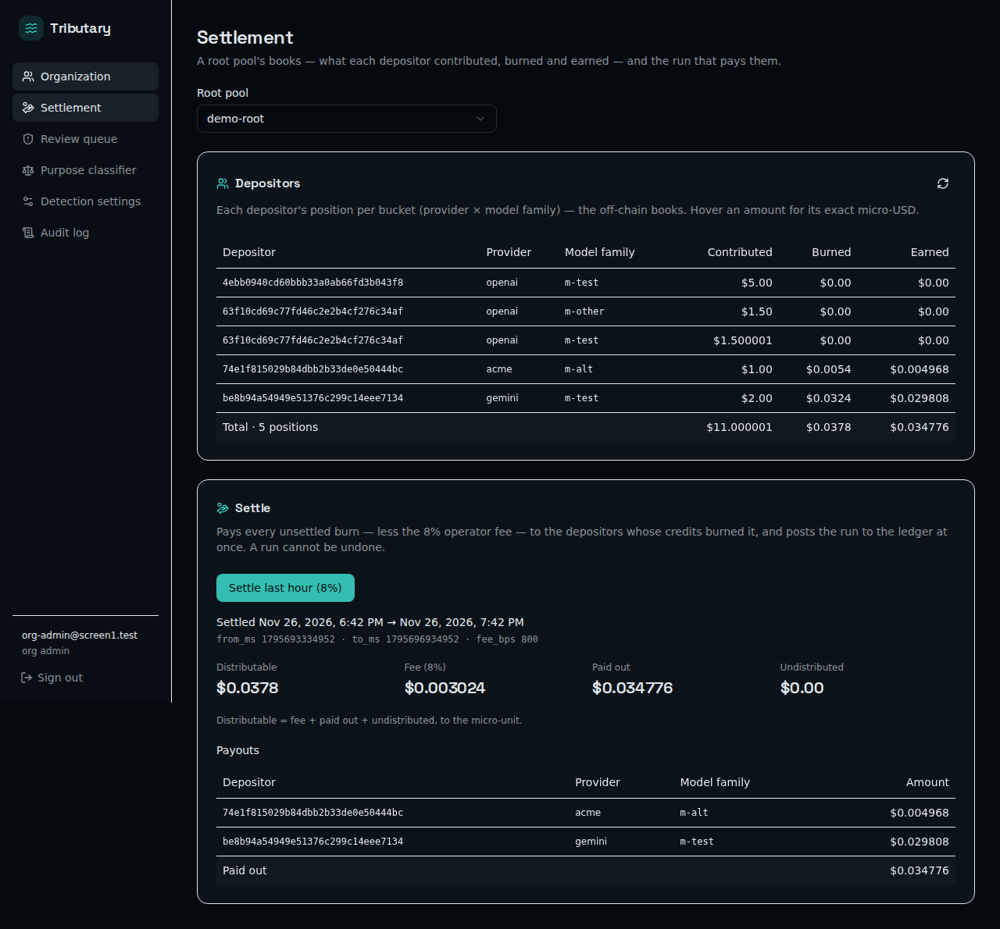
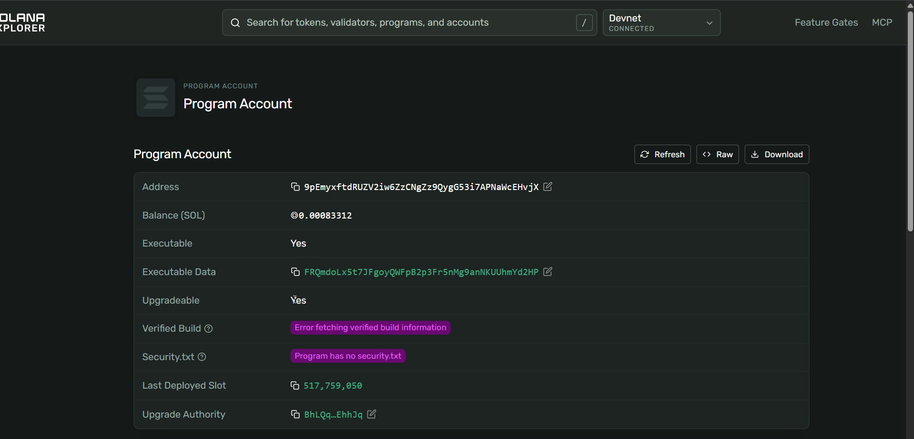

# Tributary

[](https://github.com/Phat1911/Tributary/actions/workflows/ci.yml)
[](https://github.com/Phat1911/Tributary/releases)
[](LICENSE)

**Governed AI capacity: your team shares one AI key, everyone gets their
own, and surplus credits can earn, paid out by a Solana program.**

Solana is where the money side goes. A program has been live on devnet
since 1 November 2026. It holds a USDC escrow, takes and refunds renter
prepayments, records deposits as claims minted on the operator's word, and,
since 28 November, settles payouts: earnings become one Merkle root, a
depositor claims with a proof, and nothing pays before a challenge window.
The first root and the first paid claim are on devnet, linked below. The
escrow holds devnet USDC only, and nothing in the product funds it yet. The
rest runs on your own machine:
Tributary is also a self-hosted gateway for teams that share AI capacity.
Each member gets a personal key. Every request is metered and checked
before it reaches the provider. Every admin action that changes state lands
in an append-only audit log. Depositors put spare keys and credits into a
pool; what their credits earn is kept in a double-entry ledger, to the
micro-unit. The software is free and source-available (FSL-1.1-ALv2, which
converts to Apache-2.0 after two years) and runs in one container.

**Landing page:** <https://tributary-landing-woad.vercel.app/>. There is no hosted
demo: run it locally with the Quickstart below.


## At a glance

- **A Solana program on devnet, governed by a 2-of-2 multisig** (2-of-3 is
  the planned production posture). A USDC escrow controlled by the program,
  renter prepayments and refunds, and deposits recorded as claims have been
  live since 1 November 2026. Since 28 November it also settles payouts:
  Merkle roots, claims with a proof, a challenge window, an operator bond.
  The upgrade that added them passed the 2-of-2 multisig, and a claim has
  paid on devnet. The program can be upgraded only by a multisig vote. See
  [What exists today](#what-exists-today).
- **Surplus credits can earn.** A pool of kind `root` accepts depositor
  credits. Each request's cost is metered to the micro-unit against the
  depositor whose credits burned, and posted to the books when the window
  is settled. A settle run pays each depositor what their credits earned,
  minus an 8% operator fee, once per window.
- **Per-member keys over pooled capacity.** Quotas and rate limits run at
  the gateway before any upstream call. Provider keys are envelope-encrypted
  at rest and shown afterwards only as a prefix and a last four.
- **Governance that leaves a record.** Leak signals (for example one key
  seen from two networks) raise review flags. An audit log, enforced
  append-only by the database, records every control-plane action.
- **Tests before code, in public.** Security-critical features are written
  as failing tests first and then implemented to green. CI runs on every
  push to `main` and on every pull request. The security findings log,
  [`AUDIT.md`](AUDIT.md), is public.

## Why Solana

The off-chain part of Tributary, the gateway and its ledger, exists to
answer one question exactly: who earned what, to the micro-unit. The
on-chain part exists for the moment that answer turns into money between
people who do not trust each other.

- **Neither side should hold the books or the money.** An operator who runs
  the gateway controls its database, so it could alter what it owes. That is
  why the money and the payout records belong in a Solana program rather
  than in the operator's database. Today the escrow, the roots and the paid
  claims are all on devnet.
- **No single key can upgrade the program; a payout is a public event with
  a pause before it.** The escrow is a token account controlled by the
  program. A prepayment is signed by the paying key together with the
  operator's backend key; the paying key is normally the renter's own, and an
  operator may also fund a wallet-free renter this way (SPEC D44), a gap the
  audit tracks as A-043 until M10. A refund goes only to the renter who
  prepaid, up to that renter's on-chain record. Payouts have a different
  shape, stated plainly: the backend key alone can post a root naming any
  pubkey, up to the whole escrow, and open the assisted claim once the
  window has passed. What stands between that and a theft is the window
  itself: anyone can challenge the root and freeze its payouts, and only the
  2-of-2 multisig can rule. Its vault is also the upgrade authority; the
  upgrade that put the settlement code in place, on 28 November, is
  [on-chain](https://explorer.solana.com/tx/37JFtEwYtSxHguzvGYjTv97vyMwR7ZSbyXddwFte6cgwjtwEcjn8r8CTsP6wTsCrZM4rm2v1mTEwZR5DvNeZ7KHN?cluster=devnet).
- **The chain does money; servers do speed.** No AI request ever routes
  on-chain. Metering, quotas and leak detection stay off-chain, where they
  are fast and keep usage data private; Solana carries only the money and
  its receipts.
- **Payouts are settled, not negotiated.** Earnings are merkleized into one
  root; a depositor claims with a proof; payouts wait for a challenge
  window; a root can never pay more than it declares (SPEC D45). These rules
  were written as twelve failing tests before any code existed. Since
  28 November the code is live on devnet and the tests are green.

### The program, precisely

Fifteen instructions, in `programs/pool/src/lib.rs` (the interface is
tracked as [`programs/pool/idl/pool.json`](programs/pool/idl/pool.json)),
each with its own tests in `programs/pool/tests`:

| Instruction | Who signs | What it does |
|---|---|---|
| `initialize` | the deployment authority (the multisig's vault) and a fee payer | creates the pool, its USDC escrow and a non-transferable claim mint, all program-derived accounts |
| `record_contribution` | the operator's backend key | mints claim records for a depositor: an attestation from the books. The chain checks the signer and the arithmetic, not a deposit's value |
| `burn_claims` | the depositor, or the backend key | burns a depositor's claim records |
| `prepay_renter` | the renter **and** the backend key | USDC into the escrow, recorded per renter |
| `refund_renter` | the renter, or the backend key; the program signs the transfer | USDC back to that renter only, capped by the renter's record |
| `pause`, `resume` | the admin authority, the multisig's vault | halt or restore every movement of funds |
| `set_backend_authority`, `set_admin_authority` | the admin authority | rotates the operator and admin keys |
| `fund_bond` | the backend key (the operator), which also pays | USDC from the operator's own wallet into a bond vault; the bond backs every root the operator posts |
| `post_root` | the backend key | records a window's Merkle root and its total, stamped with the slot; refuses a total above the escrow's balance, and a second root for the same window |
| `claim` | the depositor, or the backend key; a payer covers the claim marker's rent | checks the proof against the root, waits for the challenge window, pays the leaf's depositor from the escrow and adds the amount to the root's `paid_out` |
| `challenge` | any key | freezes a root's payouts until the multisig rules; only inside the challenge window |
| `resolve_challenge` | the admin authority, the multisig's vault | rules a challenged root: it stands (the rest of the window is waived), or it is false, with an exact slash and its victim recorded |
| `slash_bond` | no signer | executes a ruled slash from the bond vault to the recorded victim |

Three facts a reader should not have to dig for. The escrow holds **devnet
USDC only**; after the first paid claim it holds 0.050960, a renter's
unspent prepayment, and nothing in the product funds it for payouts yet
(the open earlier milestone, M10). A deposit on-chain is a claim record the
operator attests to: the chain verifies who signed, not what the deposit is
worth. And what a depositor has is a check on it: a payout root that can be
checked against the published payouts, and a challenge window before anything
is paid. Addresses and evidence: [What exists today](#what-exists-today).

## The problem it solves

Small teams share one AI key by pasting it into a group chat. Nobody can
tell who spent what. One heavy user can drain the quota. A leaked key is
discovered on the provider's invoice. The spare credit sitting on that key
earns nothing. Hosted API routers solve the first three problems by taking
your keys, your credits and your usage data. Tributary takes the other
road: the team keeps its own keys, on its own machine. It was built by a
student developer who kept running into exactly this trade.

When the people holding credits and the people needing them are strangers,
neither side should hold the money or the books. That is the part a
blockchain is for.

- **No middleman, no markup.** You pay provider prices directly.
- **Your keys and usage stay in the building by default.** One optional
  exception exists, and the organisation controls it: the purpose
  classifier is off by default and disclosed to members.
- **A router is something you rent; this is a building you own.**

**The other side of the same key.** Granted credits, such as hackathon
prizes, education allocations and promotional credit, often come with an
expiry date, and one person rarely uses them up in time. For their
holders, selling what they cannot use, below face value, is salvage rather
than a price war; for a buyer, it is capacity at a discount. Hackathon
credits are the clearest case. Tributary's settlement layer is being built
for exactly that supply, wherever the provider's terms allow it. AI agents
feel both problems most: they are commonly run on granted credits, and in
Tributary an agent is simply a member, with its own key and quota, calling
the OpenAI-compatible API without a wallet.

## How it works



### Off the chain

1. A member or an agent calls the gateway with **their own pool key**, using
   the OpenAI-compatible API.
2. The gateway **meters the request, checks quotas and watches for leaks**
   before any upstream call. It then forwards to the provider with a
   depositor's key.
3. The cost of the request is **metered to the micro-unit** against the
   depositor whose credits burned.
4. At **settle**, the consumed capacity is posted to the **double-entry
   ledger**, and the books say exactly what each depositor earned: the burn
   minus an 8% operator fee. A window is settled once and cannot be paid
   twice.
5. Every admin action that changes state is written to the **append-only
   audit log**.

### On the chain

1. The payouts are merkleized and the **root is posted to the Solana
   program**. A depositor claims with a proof after a challenge window, and
   a root can never pay more than it declares. Live on devnet since
   28 November: [a claim paid](https://explorer.solana.com/tx/278rWKHN8aSEr26Fmbwe9H4CRBXWeU3e6iWjBGVZNj3fuzseHiNiuCtANDowtyvmg1CkkwbskBRoZGNCRuywMpJR?cluster=devnet) 149,040 micro-USDC to a depositor.

A reproducible run, from the no-key walkthrough
([`docs/founder-journey-settlement-screen.md`](docs/founder-journey-settlement-screen.md),
Part B): two requests against the repository's mock upstream burn **2,700
micro-USD** each, **5,400** in total. The settle run returns an operator fee
of **432** and pays out **4,968**, and the same two figures appear on the
settlement screen and in the ledger rows. (This version prices every token
at a flat 150 micro-USD; the provider's real price table is not wired in
yet.)

The settlement screen, with a five-depositor root pool after one 8% settle
run (distributable $0.0378, fee $0.003024, paid out $0.034776):



## What exists today

| Part | State | Evidence |
|---|---|---|
| Solana program: escrow vault, deposits, renter prepayment | Live on devnet since 2026-11-01 | [Program account](https://explorer.solana.com/address/9pEmyxftdRUZV2iw6ZzCNgZz9QygG53i7APNaWcEHvjX?cluster=devnet), [2-of-2 upgrade transaction](https://explorer.solana.com/tx/576QrbHPxvDB3P63nHedFA5hDqVBXJchzkauEvrpAJzHUyyDCnfd6KhXaRw2gePS7RF2NQh2eM5qsgj6wwCdeaP5?cluster=devnet), [soak report](docs/devnet-soak-m8.md) |
| Adversarial audits | The escrow program was audited on 2026-11-02 and depositor mode on 2026-11-18 (eight findings); their findings were fixed or formally accepted (2026-11-02 and 2026-11-19); one residual raised since is open (A-061) | [`AUDIT.md`](AUDIT.md), [threat model](docs/threat-model.md) |
| Gateway, organisation pools, dashboard (V1) | Released as v0.1.4 | [Release](https://github.com/Phat1911/Tributary/releases), [CI](https://github.com/Phat1911/Tributary/actions/workflows/ci.yml), the [Quickstart](#try-it) below |
| Depositor pools, double-entry ledger, settle API | Experimental. In v0.1.4 in a pre-audit form; the audited settle (idempotent, posting to the books) is on `main` only, not yet in the release image | `crates/gateway`, `crates/ledger`; the [settlement journey](docs/founder-journey-settlement-screen.md) walks through the public API; the audit and fix log is in [`PLAN.md`](PLAN.md) (2026-11-18 and 2026-11-19) |
| Settlement screen | On `main` after v0.1.4; ships in the next release | Screenshot above; `apps/dashboard/app/org/settlement` |
| Merkle-settled payouts: bond, root, claim, challenge window, payout cap | **Live on devnet since 2026-11-28**, built tests-first: twelve rules as failing tests on 26 November, implemented to 54 of 54 green on 27 November, upgraded through the 2-of-2 multisig, and a claim paid on 28 November | [The paid claim](https://explorer.solana.com/tx/278rWKHN8aSEr26Fmbwe9H4CRBXWeU3e6iWjBGVZNj3fuzseHiNiuCtANDowtyvmg1CkkwbskBRoZGNCRuywMpJR?cluster=devnet), [the 2-of-2 upgrade](https://explorer.solana.com/tx/37JFtEwYtSxHguzvGYjTv97vyMwR7ZSbyXddwFte6cgwjtwEcjn8r8CTsP6wTsCrZM4rm2v1mTEwZR5DvNeZ7KHN?cluster=devnet), the [devnet report](docs/devnet-m11.md), [`programs/pool/tests/m11_doctrine.rs`](programs/pool/tests/m11_doctrine.rs) |




The program's upgrade authority is `BhLQqw5rkr3otQoXvJSRjiaNHTgdcgXVkqXv8mwEhhJq`,
the first vault of a [2-of-2 Squads multisig](https://explorer.solana.com/address/GuSeFfFkdKtjkubeLUEeBHW5pfHSJctGnz8AFk7xrCk5?cluster=devnet).
No single key can upgrade it.

## Try it

> **Which terminal?** Run these in a **POSIX shell**: Linux, macOS, or WSL on
> Windows (enable Docker Desktop's WSL integration, check with `docker ps`),
> and paste the block as-is. **Windows PowerShell** works line by line
> instead: split the first line at `&&`, use `Copy-Item deploy\.env.example
> .env`, drop the trailing `\` continuations, and generate the key in WSL or
> Git Bash (`openssl rand -hex 32`). CMD is not supported.

```sh
git clone https://github.com/Phat1911/Tributary.git && cd Tributary
cp deploy/.env.example .env
echo "TRIBUTARY_MASTER_KEY=$(openssl rand -hex 32)" >> .env   # REQUIRED — your vault key; keep it secret
docker compose up -d          # prefers the prebuilt image; builds from source only as fallback
docker exec -it \
  -e TRIBUTARY_DATABASE_URL=sqlite:///data/tributary.db \
  -e TRIBUTARY_ADMIN_PASSWORD="$(openssl rand -base64 18)" \
  tributary tributary create-admin --email you@example.com
# (--password '<secret>' on the command line also works, but it lands in
#  your shell history; the env var is the documented path)
```

```sh
# compose-free equivalent (same container, same volume, shipped image):
docker run -d --name tributary -p 8111:8080 --env-file .env \
  -v tributary-data:/data --restart unless-stopped ghcr.io/phat1911/tributary:latest
```

**Sign in at http://localhost:8111.** Time to first login is about **2
minutes with the prebuilt image** (the first `up` pulls about 40 MB), or
**10–15 minutes if it builds from source** (a cold Rust and dashboard
compile).

**The `:latest` image is release v0.1.4.** It contains depositor pools in
their pre-audit form, but not the audited settle or the settlement screen;
those are on `main` and need an image built from it.

> **If `docker compose up -d` says `unknown shorthand flag: 'd'`:** the
> compose plugin is missing. Fix: Docker Desktop → Settings → Resources →
> **WSL Integration** on, or `apt install docker-compose-plugin`; or use the
> compose-free command above.

> **If you see `permission denied ... /var/run/docker.sock`:** your user is
> not in the docker group. Fix: `sudo usermod -aG docker $USER && newgrp
> docker` (or restart WSL), then check that `docker ps` runs without sudo.
> WSL-native Docker also needs `sudo service docker start`.

> **Behind a reverse proxy:** set `TRIBUTARY_TRUSTED_PROXIES` to that
> proxy's CIDR. IP-derived controls (allowlists, sharing detection) are only
> sound then; without it, X-Forwarded-For is ignored and the socket address
> is used. Details: [`deploy/README.md`](deploy/README.md).

> **Provider keys (OpenAI and Gemini):** pools accept keys from any
> OpenAI-compatible endpoint. A Google AI Studio (Gemini) key goes in with
> provider *Gemini* and base URL
> `https://generativelanguage.googleapis.com/v1beta/openai`. Member traffic
> is then metered, quota-checked and leak-watched exactly like
> OpenAI-routed traffic. Tributary speaks the OpenAI-compatible wire format
> on all pools; it is not a format converter, and the native Gemini API
> shape is not translated. The free tier of AI Studio is rate-limited: fine
> for demos and pilots, but expect upstream 429s under load.

### See the settlement

Sign in with any admin account, including the one `create-admin` made
(`POST /api/v1/auth/login`), keep the returned token in `TOKEN`, create an
organisation (`POST /api/v1/orgs` with `{"name":"…","slug":"…"}`) and use
its `id` below:

```sh
API=http://localhost:8111/api/v1
# 1. a root pool, then a deposit (any OpenAI-compatible endpoint and its key)
curl -s -X POST $API/pools -H "Authorization: Bearer $TOKEN" -H 'content-type: application/json' \
  -d '{"org_id":"<org id>","name":"credit-pool","kind":"root","model_allowlist":["gpt-4o-mini"]}'
curl -s -X POST $API/pools/<pool id>/deposits -H "Authorization: Bearer $TOKEN" -H 'content-type: application/json' \
  -d '{"provider":"openai","key":"<a provider key>","base_url":"https://api.openai.com/v1","model_families":["gpt-4o-mini"],"contributed_micros":5000000}'
# 2. send a request with a member key (the dashboard issues one), then read the books
curl -s $API/pools/<pool id>/bucket-positions -H "Authorization: Bearer $TOKEN"
# 3. settle a window (here: the last hour) with an 8% fee
curl -s -X POST $API/pools/<pool id>/settle -H "Authorization: Bearer $TOKEN" -H 'content-type: application/json' \
  -d "{\"from_ms\":$(( ($(date +%s) - 3600) * 1000 )),\"to_ms\":$(date +%s)000,\"fee_bps\":800}"
```

On an image built from `main`, the dashboard shows the same books under
**Settlement**. A complete walkthrough that needs no real key (it uses the repository's mock upstream)
is [`docs/founder-journey-settlement-screen.md`](docs/founder-journey-settlement-screen.md).

### Verify the on-chain part yourself

- Open the [program account on devnet](https://explorer.solana.com/address/9pEmyxftdRUZV2iw6ZzCNgZz9QygG53i7APNaWcEHvjX?cluster=devnet):
  *Upgradeable: yes*, and *Upgrade authority* `BhLQqw…`, the multisig's vault.
- Open [the paid claim](https://explorer.solana.com/tx/278rWKHN8aSEr26Fmbwe9H4CRBXWeU3e6iWjBGVZNj3fuzseHiNiuCtANDowtyvmg1CkkwbskBRoZGNCRuywMpJR?cluster=devnet): under *Token Balance Changes*, the
  escrow `Dhp3t3…` loses 0.14904 USDC and the depositor's token account gains
  exactly that.
- Open [the upgrade that added settlements](https://explorer.solana.com/tx/37JFtEwYtSxHguzvGYjTv97vyMwR7ZSbyXddwFte6cgwjtwEcjn8r8CTsP6wTsCrZM4rm2v1mTEwZR5DvNeZ7KHN?cluster=devnet): proposal 11 on the
  [multisig](https://explorer.solana.com/address/GuSeFfFkdKtjkubeLUEeBHW5pfHSJctGnz8AFk7xrCk5?cluster=devnet), approved by two members and executed by the Squads
  program, with the vault signing the inner *Upgrade*.
- Run the settlement rules yourself. On `main`, with the toolchain pinned in
  CI (Agave v4.1.2; a cold build takes well over two minutes):
  `cd programs/pool && cargo-build-sbf --arch v3 && cd ../.. && cargo test -p pool`.
  All 54 program tests pass, the twelve rule-named tests among them.

## Built at Dev3pack × DSUC (Da Nang, 27–29 November 2026)

Tributary is a submitted project at the Dev3pack × DSUC Build Station
hackathon. The event's work is on Solana: Merkle-settled payouts for AI
credit pools, built tests-first. Receipts are listed here as they land: commits, CI runs and
devnet transactions.

- **Before the event (26 November):** the settlement screen
  ([`1f12408`](https://github.com/Phat1911/Tributary/commit/1f12408)) and
  the twelve settlement rules as failing tests
  ([`2bcd448`](https://github.com/Phat1911/Tributary/commit/2bcd448)).
- **27 November, tests to green.** The six settlement instructions and
  SHA-256 by the `sol_sha256` syscall in [`d611b9f`](https://github.com/Phat1911/Tributary/commit/d611b9f); two
  test-construction bugs found by the implementation session and fixed only
  on the founder's ruling in [`5420044`](https://github.com/Phat1911/Tributary/commit/5420044); the IDL tracked in
  [`a912a7a`](https://github.com/Phat1911/Tributary/commit/a912a7a); merged to `main` in the night of 27–28 November,
  [`02cbac8`](https://github.com/Phat1911/Tributary/commit/02cbac8),
  [CI green](https://github.com/Phat1911/Tributary/actions/runs/46091883349): 54 of 54 program tests.
- **28 November, on devnet.** The program upgraded through the 2-of-2
  multisig: proposal 11, approved by two members, executed in
  [`37JFtEwY…`](https://explorer.solana.com/tx/37JFtEwYtSxHguzvGYjTv97vyMwR7ZSbyXddwFte6cgwjtwEcjn8r8CTsP6wTsCrZM4rm2v1mTEwZR5DvNeZ7KHN?cluster=devnet) at slot 527064271, the authority still the vault.
  Then a settle run driven by the recorded demo's figure (a one-leaf
  payouts file written by hand; the glue does not yet read the gateway's
  settle output): a renter prepaid 0.20 USDC, the operator bonded 0.14904 USDC, [a root was
  posted](https://explorer.solana.com/tx/rCCt6PWnthZxrkkHo9DgmvTishS9QfgWEa7Va6enug39wowTpwVNwXnuPoViy1qNS6e8qSneaywfNqjkfmf3TKR?cluster=devnet) for 149,040 micro-USDC, and after the 100-slot window
  [a claim paid](https://explorer.solana.com/tx/278rWKHN8aSEr26Fmbwe9H4CRBXWeU3e6iWjBGVZNj3fuzseHiNiuCtANDowtyvmg1CkkwbskBRoZGNCRuywMpJR?cluster=devnet) exactly 149,040. Every signature is in
  [`docs/devnet-m11.md`](docs/devnet-m11.md); the tooling is on `main` since
  [`c161463`](https://github.com/Phat1911/Tributary/commit/c161463), [CI green](https://github.com/Phat1911/Tributary/actions/runs/46101579399).
- **The red run first:** [the twelve rules failing before any code
  existed](https://github.com/Phat1911/Tributary/actions/runs/45791887787), 26 November.
- **Next:** an adversarial audit of the settlement code. Its findings, if
  any, go to [`AUDIT.md`](AUDIT.md) as they arrive.

## Security and known limits

Read first: the [threat model](docs/threat-model.md) (what is audited, what
is not independently reviewed yet), [`SECURITY.md`](SECURITY.md) (private
disclosure by email) and [`AUDIT.md`](AUDIT.md) (every finding, with
evidence, in public).

Stated limits, as of this writing:

- **Depositor mode is experimental.** It was adversarially audited on
  2026-11-18; its eight findings were fixed or formally accepted on
  2026-11-19. One high-severity finding has been raised since and is open,
  **A-061**: the order in which depositors serve a model family can be
  steered by a depositor-supplied provider name. It is present in the
  v0.1.4 image; it cannot fire while every deposit in a pool uses the same
  `provider` string, as the walkthrough does. It has been
  ruled (the order will depend on contributed weight and deposit age,
  never on a supplied string) and is scheduled for the next fix session.
- **Failed upstream calls that answer with an HTTP error still burn the
  reserve estimate** (A-062). The founder has ruled that an HTTP-error
  answer must not burn the depositor's credits; the floor stays for
  successful answers that report no usage. The fix is scheduled with A-061.
- **On-chain money is devnet money.** Deposits and earnings are micro-USD
  book entries. On devnet a deposit is a claim record (SPEC D40); the escrow
  holds renter prepayments only, and nothing in the product funds it for
  payouts yet (M10). The program fixes the unit, one micro-USD is one USDC
  base unit, with no conversion.
- **The settlement code is one day old: proven by its tests, not yet by an
  adversary.** Its twelve rules are green and a claim has paid on devnet;
  the adversarial audit is the next step and its findings will be public in
  `AUDIT.md`. Gaps its own builder states: only `fund_bond` respects the
  pause switch; `resolve_challenge` refuses an unchallenged root, which no
  test pins; a slash is capped by the bond as it stood when the root was
  posted; any key may challenge, so one key can freeze a root's payouts
  until the multisig rules. The window is a fixed 100-slot constant,
  sized for a demo, and must become a parameter before any mainnet use.
- **What the devnet run did not exercise.** The paid claim used the assisted
  door (the backend opened it for the depositor); the direct door, a
  challenge and a slash are proven by the local suite, not re-run on devnet.
  In that run the renter and the depositor were one custodial key, as in the
  November soak.
- **Three gaps the builder names, still open.** There is no instruction to
  unbond, so an operator's bond stays locked until a slash moves it; window
  numbers need not increase, so a later root could reuse an earlier
  window's number; and a slash waits if the bond vault holds less than the
  ruling.
- **The program is on devnet only.** It has no on-chain `security.txt` and
  no verified build yet.
- **The challenge window is a fixed 100-slot constant,** sized for a demo.

Non-negotiables, from [`SPEC.md`](SPEC.md): deposits are keys and credits
only, never subscription logins or browser automation of consumer plans;
provider keys are envelope-encrypted at rest, with the master key never in
the database; the ledger is append-only, enforced at the database; quota and
rate-limit checks always run at the gateway before any upstream call.

## Business model, plainly

V1 is free forever, by strategy: adoption first, zero recurring cost. The
first dollar Tributary plans to earn is an operator's settlement fee (a
fixed 5–10% band) on marketplace volume, paid by operators, never by
members. In V1 the operator is the team that runs the instance; the 8%
is a parameter of the settle run and today it moves no money, it only
splits two ledger accounts. That marketplace opens only behind provider and
reseller agreements for credit transfer; no such agreement exists today.
Until that gate opens, Tributary is exactly what you see: a free,
self-hosted governance tool with its settlement layer on devnet. No dollar
is planned from terms-of-service-gray flows.

Self-hosted *and* a marketplace? The boundary: V1 is governance inside one
trust domain, with no blockchain, and your keys and usage data stay in your
building. The marketplace is opt-in, pool by pool, built for teams and
individuals holding surplus AI credits (students, startups, labs) supplying
them, and cost-conscious builders drawing from them. That market lives on
supply whose cost is already paid: granted credits, hackathon prizes,
education allocations, expiring promotions, and committed spend a team has
paid for but will not consume. For that supply, selling below face value is
salvage, not a price war. Where strangers
exchange value, and nowhere else, the chain carries the receipts:
append-only books, an escrow that only the program's own instructions can
move, every money moment a public record. Credits bought at face value never enter that market; the
official provider is the right answer for those.

## Where to go next

| Document | What it covers |
|---|---|
| [`deploy/README.md`](deploy/README.md) | Ports, reverse proxies (the trusted-proxy setting matters), backups, Postgres, healthchecks, quota behaviour, upgrades |
| [`docs/threat-model.md`](docs/threat-model.md) | What is audited and how, what is **not** independently reviewed yet, bus factor |
| [`docs/onboarding-org-admin.md`](docs/onboarding-org-admin.md) | Admin first-day guide (draft): empty box → org → pool → member key → first request |
| [`docs/pilot-support.md`](docs/pilot-support.md) | "It broke" diagnostics: healthz → logs → audit → review queue |
| [`docs/founder-journey-settlement-screen.md`](docs/founder-journey-settlement-screen.md) | Depositor pools, the settle API and the settlement screen, end to end |
| [`docs/devnet-soak-m8.md`](docs/devnet-soak-m8.md) | The live devnet rehearsal: deploy, multisig hand-over, refused single-key upgrade, upgrade by 2-of-2 vote |
| [`docs/devnet-m11.md`](docs/devnet-m11.md) | Settlements on devnet: the 2-of-2 upgrade, a root posted, a claim paid, every signature linked |
| [`SPEC.md`](SPEC.md) · [`PLAN.md`](PLAN.md) · [`AUDIT.md`](AUDIT.md) | Rules and roadmap · status log · every finding |
| [`SECURITY.md`](SECURITY.md) · [`CONTRIBUTING.md`](CONTRIBUTING.md) | Private disclosure · conventions and dev setup |
| [Pilot feedback](https://github.com/Phat1911/Tributary/issues/new?template=pilot-feedback.yml) | Running a pilot? Tell us what worked and what broke |
| [`LICENSE`](LICENSE) | FSL-1.1-ALv2: each version converts to Apache-2.0 after two years |

## Repository layout

```
crates/            Rust workspace: gateway (OpenAI-compatible proxy, metering),
                   control (admin API, auth), ledger, crypto, common
apps/dashboard/    Next.js + TypeScript dashboard (pnpm workspace), baked into the image
programs/pool/     Solana program (Anchor): escrow vault, deposits, renter prepayment;
                   Merkle settlement (in progress)
migrations/        sqlx migrations, run on SQLite and Postgres
scripts/           demo seed, mock upstreams, OpenAI-SDK contract test, devnet soak tool
deploy/            Dockerfile, entrypoint, .env.example: single-container deployment
docker-compose.yml the Quickstart deployment (reads a gitignored .env)
landing/           the landing page, published on GitHub Pages
docs/              threat model, devnet soak report, founder journeys, operations
SPEC.md            product and design rules, decision log, roadmap
PLAN.md            status and milestone log
AUDIT.md           security and spec-conformance findings, with evidence
AGENTS.md          the working agreement for people and AI agents in this repo
```

## Developing and verification

Rust:

```sh
cargo fmt --all -- --check
cargo clippy --workspace --all-targets -- -D warnings
cargo test --workspace
```

Dashboard:

```sh
pnpm install
pnpm -C apps/dashboard build
```

Solana program (toolchain pinned in CI, Agave v4.1.2):

```sh
cd programs/pool && cargo-build-sbf --arch v3 && cd ../.. && cargo test -p pool
```

CI ([`.github/workflows/ci.yml`](.github/workflows/ci.yml)) runs five jobs
on every push to `main` and on every pull request: **rust** (fmt, clippy with warnings denied, the test suite on
SQLite and Postgres), **dashboard** (lint, typecheck, build), **e2e**
(Playwright journeys against a real stack), **sdk-contract** (the official
OpenAI SDKs against OpenAI- and Gemini-compatible upstreams) and **deny**
(cargo-deny).

## Author and license

Built by Tran Dinh Hong Phat (Hong Phat), a second-year IT student in Da
Nang, Vietnam. One maintainer builds Tributary today; the
[threat model](docs/threat-model.md) says so plainly.

Copyright 2026 Tran Dinh Hong Phat. Licensed under the
[Functional Source License, Version 1.1, ALv2 Future License](LICENSE)
(FSL-1.1-ALv2). Each version converts to Apache-2.0 two years after it is
made available.
