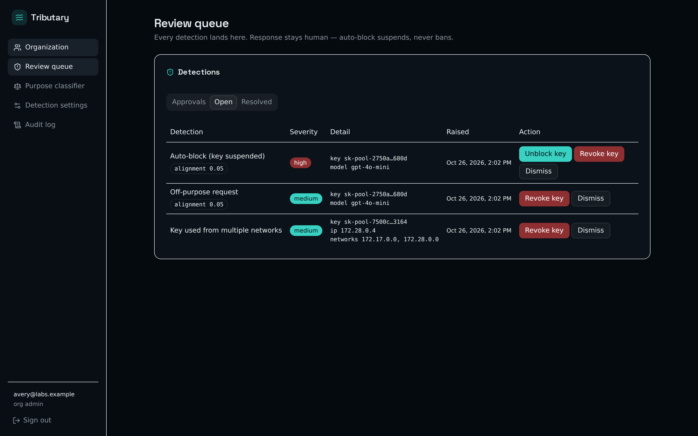

# Tributary

[](https://github.com/Phat1911/Tributary/actions/workflows/ci.yml)
[](https://github.com/Phat1911/Tributary/releases)
[](LICENSE)

**Governed AI capacity: your team shares one AI key, everyone gets their
own, and spare credits can earn, with Solana payouts in progress on devnet.**

Tributary is a self-hosted gateway for teams that share AI capacity. Each
member gets a personal key. Every request is metered and checked before it
reaches the provider. Every admin action lands in an append-only audit log.
Depositors can put spare keys and credits into a pool; what their credits
earn is kept in a double-entry ledger. Paying those earnings out through a
Solana program is the part being built now. The software is free and
source-available (FSL-1.1-ALv2, which converts to Apache-2.0 after two
years) and runs in one container on your own machine.

**Landing page:** <https://phat1911.github.io/Tributary/>. There is no hosted
demo: run it locally with the Quickstart below.


## At a glance

- **Per-member keys over pooled capacity.** Quotas and rate limits run at
  the gateway before any upstream call. Provider keys are envelope-encrypted
  at rest and shown afterwards only as a prefix and a last four.
- **Governance that leaves a record.** Leak signals (for example one key
  seen from two networks) raise review flags. An audit log, enforced
  append-only by the database, records every control-plane action.
- **Depositor pools with real books.** A pool of kind `root` accepts
  depositor credits. Each request's cost is metered to the micro-unit
  against the depositor whose credits burned, and posted to the books when
  the window is settled. A settle run pays each depositor what their
  credits earned, minus an 8% operator fee, once per window.
- **A Solana program on devnet, governed by a 2-of-2 multisig** (2-of-3 is
  the planned production posture). A USDC escrow, deposits and renter
  prepayments are live. Merkle-settled payouts
  are being built tests-first: see [What exists today](#what-exists-today).
- **Tests before code, in public.** Security-critical features are written
  as failing tests first and then implemented to green. CI runs on every
  push to `main` and on every pull request. The security findings log,
  [`AUDIT.md`](AUDIT.md), is public.

## The problem it solves

Small teams share one AI key by pasting it into a group chat. Nobody can
tell who spent what. One heavy user can drain the quota. A leaked key is
discovered on the provider's invoice. The spare credit sitting on that key
earns nothing. Hosted API routers solve the first three problems by taking
your keys, your credits and your usage data. Tributary takes the other
road: the team keeps its own keys, on its own machine. It was built by a
student developer who kept running into exactly this trade.

- **No middleman, no markup.** You pay provider prices directly.
- **Your keys and usage stay in the building by default.** One optional
  exception exists, and the organisation controls it: the purpose
  classifier is off by default and disclosed to members.
- **A router is something you rent; this is a building you own.**

## How it works


1. A member or an agent calls the gateway with **their own pool key**, using
   the OpenAI-compatible API.
2. The gateway **meters the request, checks quotas and watches for leaks**
   before any upstream call. It then forwards to the provider with a
   depositor's key.
3. The cost of the request is **metered to the micro-unit** against the
   depositor whose credits burned.
4. At **settle**, the consumed capacity is posted to the **double-entry
   ledger**, and the books say exactly what each depositor earned: the burn
   minus an 8% operator fee. A window is settled once and cannot be paid
   twice.
5. The payouts are merkleized and the **root is posted to the Solana
   program**. A depositor claims with a proof after a challenge window.
   *This step is being built now: its twelve rules already exist as failing
   tests (see [What exists today](#what-exists-today)).*
6. Every control-plane action is written to the **append-only audit log**.

A reproducible run, from the no-key walkthrough
([`docs/founder-journey-settlement-screen.md`](docs/founder-journey-settlement-screen.md),
Part B): two requests against the repository's mock upstream burn **2,700
micro-USD** each, **5,400** in total. The settle run returns an operator fee
of **432** and pays out **4,968**, and the same two figures appear on the
settlement screen and in the ledger rows. (This version prices every token
at a flat 150 micro-USD; the provider's real price table is not wired in
yet.)

The settlement screen, with a five-depositor root pool after one 8% settle
run (distributable $0.0378, fee $0.003024, paid out $0.034776):


## What exists today

| Part | State | Evidence |
|---|---|---|
| Gateway, organisation pools, dashboard (V1) | Released as v0.1.4 | [Release](https://github.com/Phat1911/Tributary/releases), [CI](https://github.com/Phat1911/Tributary/actions/workflows/ci.yml), the [Quickstart](#try-it) below |
| Depositor pools, double-entry ledger, settle API | Experimental. In v0.1.4 in a pre-audit form; the audited settle (idempotent, posting to the books) is on `main` only, not yet in the release image | `crates/gateway`, `crates/ledger`; the [settlement journey](docs/founder-journey-settlement-screen.md) walks through the public API; the audit and fix log is in [`PLAN.md`](PLAN.md) (2026-11-18 and 2026-11-19) |
| Settlement screen | On `main` after v0.1.4; ships in the next release | Screenshot above; `apps/dashboard/app/org/settlement` |
| Solana program: escrow vault, deposits, renter prepayment | Live on devnet since 2026-11-01 | [Program account](https://explorer.solana.com/address/9pEmyxftdRUZV2iw6ZzCNgZz9QygG53i7APNaWcEHvjX?cluster=devnet), [2-of-2 upgrade transaction](https://explorer.solana.com/tx/576QrbHPxvDB3P63nHedFA5hDqVBXJchzkauEvrpAJzHUyyDCnfd6KhXaRw2gePS7RF2NQh2eM5qsgj6wwCdeaP5?cluster=devnet), [soak report](docs/devnet-soak-m8.md) |
| Merkle-settled payouts: root, claim, challenge window, payout cap | In progress: twelve rules written as failing tests, implementation next | [The tests](https://github.com/Phat1911/Tributary/blob/m11/doctrine-suite/programs/pool/tests/m11_doctrine.rs) on branch `m11/doctrine-suite`, and [their CI run, red by design](https://github.com/Phat1911/Tributary/actions/runs/45791887787) |
| Adversarial audits | The escrow program was audited and fixed (2026-11-02); depositor mode was audited on 2026-11-18 (eight findings) and fixed on 2026-11-19; one residual found since is open (A-061) | [`AUDIT.md`](AUDIT.md), [threat model](docs/threat-model.md) |




The program's upgrade authority is `BhLQqw5rkr3otQoXvJSRjiaNHTgdcgXVkqXv8mwEhhJq`,
the first vault of a [2-of-2 Squads multisig](https://explorer.solana.com/address/GuSeFfFkdKtjkubeLUEeBHW5pfHSJctGnz8AFk7xrCk5?cluster=devnet).
No single key can upgrade it.

## Try it

> **Which terminal?** Run these in a **POSIX shell**: Linux, macOS, or WSL on
> Windows (enable Docker Desktop's WSL integration, check with `docker ps`),
> and paste the block as-is. **Windows PowerShell** works line by line
> instead: split the first line at `&&`, use `Copy-Item deploy\.env.example
> .env`, drop the trailing `\` continuations, and generate the key in WSL or
> Git Bash (`openssl rand -hex 32`). CMD is not supported.

```sh
git clone https://github.com/Phat1911/Tributary.git && cd Tributary
cp deploy/.env.example .env
echo "TRIBUTARY_MASTER_KEY=$(openssl rand -hex 32)" >> .env   # REQUIRED — your vault key; keep it secret
docker compose up -d          # prefers the prebuilt image; builds from source only as fallback
docker exec -it \
  -e TRIBUTARY_DATABASE_URL=sqlite:///data/tributary.db \
  -e TRIBUTARY_ADMIN_PASSWORD="$(openssl rand -base64 18)" \
  tributary tributary create-admin --email you@example.com
# (--password '<secret>' on the command line also works, but it lands in
#  your shell history; the env var is the documented path)
```

```sh
# compose-free equivalent (same container, same volume, shipped image):
docker run -d --name tributary -p 8111:8080 --env-file .env \
  -v tributary-data:/data --restart unless-stopped ghcr.io/phat1911/tributary:latest
```

**Sign in at http://localhost:8111.** Time to first login is about **2
minutes with the prebuilt image** (the first `up` pulls about 40 MB), or
**10–15 minutes if it builds from source** (a cold Rust and dashboard
compile).

**The `:latest` image is release v0.1.4.** It contains depositor pools in
their pre-audit form, but not the audited settle or the settlement screen;
those are on `main` and need an image built from it.

> **If `docker compose up -d` says `unknown shorthand flag: 'd'`:** the
> compose plugin is missing. Fix: Docker Desktop → Settings → Resources →
> **WSL Integration** on, or `apt install docker-compose-plugin`; or use the
> compose-free command above.

> **If you see `permission denied ... /var/run/docker.sock`:** your user is
> not in the docker group. Fix: `sudo usermod -aG docker $USER && newgrp
> docker` (or restart WSL), then check that `docker ps` runs without sudo.
> WSL-native Docker also needs `sudo service docker start`.

> **Behind a reverse proxy:** set `TRIBUTARY_TRUSTED_PROXIES` to that
> proxy's CIDR. IP-derived controls (allowlists, sharing detection) are only
> sound then; without it, X-Forwarded-For is ignored and the socket address
> is used. Details: [`deploy/README.md`](deploy/README.md).

> **Provider keys (OpenAI and Gemini):** pools accept keys from any
> OpenAI-compatible endpoint. A Google AI Studio (Gemini) key goes in with
> provider *Gemini* and base URL
> `https://generativelanguage.googleapis.com/v1beta/openai`. Member traffic
> is then metered, quota-checked and leak-watched exactly like
> OpenAI-routed traffic. Tributary speaks the OpenAI-compatible wire format
> on all pools; it is not a format converter, and the native Gemini API
> shape is not translated. The free tier of AI Studio is rate-limited: fine
> for demos and pilots, but expect upstream 429s under load.

### See the settlement

Sign in with any admin account, including the one `create-admin` made
(`POST /api/v1/auth/login`), keep the returned token in `TOKEN`, create an
organisation (`POST /api/v1/orgs` with `{"name":"…","slug":"…"}`) and use
its `id` below:

```sh
API=http://localhost:8111/api/v1
# 1. a root pool, then a deposit (any OpenAI-compatible endpoint and its key)
curl -s -X POST $API/pools -H "Authorization: Bearer $TOKEN" -H 'content-type: application/json' \
  -d '{"org_id":"<org id>","name":"credit-pool","kind":"root","model_allowlist":["gpt-4o-mini"]}'
curl -s -X POST $API/pools/<pool id>/deposits -H "Authorization: Bearer $TOKEN" -H 'content-type: application/json' \
  -d '{"provider":"openai","key":"<a provider key>","base_url":"https://api.openai.com/v1","model_families":["gpt-4o-mini"],"contributed_micros":5000000}'
# 2. send a request with a member key (the dashboard issues one), then read the books
curl -s $API/pools/<pool id>/bucket-positions -H "Authorization: Bearer $TOKEN"
# 3. settle a window (here: the last hour) with an 8% fee
curl -s -X POST $API/pools/<pool id>/settle -H "Authorization: Bearer $TOKEN" -H 'content-type: application/json' \
  -d "{\"from_ms\":$(( ($(date +%s) - 3600) * 1000 )),\"to_ms\":$(date +%s)000,\"fee_bps\":800}"
```

On an image built from `main`, the dashboard shows the same books under
**Settlement**. A complete walkthrough that needs no real key (it uses the repository's mock upstream)
is [`docs/founder-journey-settlement-screen.md`](docs/founder-journey-settlement-screen.md).

### Verify the on-chain part yourself

- Open the [program account on devnet](https://explorer.solana.com/address/9pEmyxftdRUZV2iw6ZzCNgZz9QygG53i7APNaWcEHvjX?cluster=devnet):
  *Upgradeable: yes*, and *Upgrade authority* `BhLQqw…`, the multisig's vault.
- Open the [upgrade transaction](https://explorer.solana.com/tx/576QrbHPxvDB3P63nHedFA5hDqVBXJchzkauEvrpAJzHUyyDCnfd6KhXaRw2gePS7RF2NQh2eM5qsgj6wwCdeaP5?cluster=devnet):
  the Squads program executes it, and the vault signs the inner *Upgrade*.
- Run the settlement rules yourself. On branch `m11/doctrine-suite`, with
  the toolchain pinned in CI (Agave v4.1.2):
  `cd programs/pool && cargo-build-sbf --arch v3 && cd ../.. && cargo test -p pool`.
  Until the implementation lands, the twelve rule-named tests fail.

## Built at Dev3pack × DSUC (Da Nang, 27–29 November 2026)

Tributary is a submitted project at the Dev3pack × DSUC Build Station
hackathon. The event's work is Merkle-settled payouts on Solana, built
tests-first. Receipts are listed here as they land: commits, CI runs and
devnet transactions.

- **Before the event (26 November):** the settlement screen
  ([`1f12408`](https://github.com/Phat1911/Tributary/commit/1f12408)) and
  the twelve settlement rules as failing tests
  ([`2bcd448`](https://github.com/Phat1911/Tributary/commit/2bcd448)).
- **During the event (27–29 November):** in progress. No Merkle root has
  been posted on devnet yet; receipts (commits, CI runs, transactions) will
  be listed here as each part lands.

## Security and known limits

Read first: the [threat model](docs/threat-model.md) (what is audited, what
is not independently reviewed yet), [`SECURITY.md`](SECURITY.md) (private
disclosure by email) and [`AUDIT.md`](AUDIT.md) (every finding, with
evidence, in public).

Stated limits, as of this writing:

- **Depositor mode is experimental.** It was adversarially audited on
  2026-11-18 and fixed on 2026-11-19. One high-severity finding has been
  raised since and is open, **A-061**: the order in which
  depositors serve a model family can be steered by a depositor-supplied
  provider name. It has been ruled (the order will depend on contributed
  weight and deposit age, never on a supplied string) and is scheduled for
  the next fix session.
- **Failed upstream calls that answer with an HTTP error still burn the
  reserve estimate** (A-062). The founder has ruled that a failed answer
  must not burn the depositor's credits; the fix is scheduled with A-061.
- **The Merkle payout rules are tests, not code,** until the implementation
  lands on `main`.
- **The program is on devnet only.** It has no on-chain `security.txt` and
  no verified build yet.
- **The challenge window is a fixed 100-slot constant,** sized for a demo.

Non-negotiables, from [`SPEC.md`](SPEC.md): deposits are keys and credits
only, never subscription logins or browser automation of consumer plans;
provider keys are envelope-encrypted at rest, with the master key never in
the database; the ledger is append-only, enforced at the database; quota and
rate-limit checks always run at the gateway before any upstream call.

## Business model, plainly

V1 is free forever, by strategy: adoption first, zero recurring cost. The
first dollar Tributary plans to earn is an operator's settlement fee (a
fixed 5–10% band) on marketplace volume, paid by operators, never by
members. That marketplace opens only behind provider and reseller
agreements for credit transfer. Until that gate opens, Tributary is exactly
what you see: a free, self-hosted governance tool. No dollar is planned from
terms-of-service-gray flows, and if the marketplace never opens, V1 stands
on its own.

Self-hosted *and* a marketplace? The boundary: V1 is governance inside one
trust domain, with no blockchain, and your keys and usage data stay in your
building. The marketplace is opt-in, pool by pool, built for teams and
individuals holding surplus AI credits (students, startups, labs) supplying
them, and cost-conscious builders drawing from them. Where strangers
exchange value, and nowhere else, the chain carries the receipts:
append-only books, escrow no single person can move, every money moment a
public record. Credits bought at face value never enter that market; the
official provider is the right answer for those.

## Where to go next

| Document | What it covers |
|---|---|
| [`deploy/README.md`](deploy/README.md) | Ports, reverse proxies (the trusted-proxy setting matters), backups, Postgres, healthchecks, quota behaviour, upgrades |
| [`docs/threat-model.md`](docs/threat-model.md) | What is audited and how, what is **not** independently reviewed yet, bus factor |
| [`docs/onboarding-org-admin.md`](docs/onboarding-org-admin.md) | Admin first-day guide (draft): empty box → org → pool → member key → first request |
| [`docs/pilot-support.md`](docs/pilot-support.md) | "It broke" diagnostics: healthz → logs → audit → review queue |
| [`docs/founder-journey-settlement-screen.md`](docs/founder-journey-settlement-screen.md) | Depositor pools, the settle API and the settlement screen, end to end |
| [`docs/devnet-soak-m8.md`](docs/devnet-soak-m8.md) | The live devnet rehearsal: deploy, multisig hand-over, refused single-key upgrade, upgrade by 2-of-2 vote |
| [`SPEC.md`](SPEC.md) · [`PLAN.md`](PLAN.md) · [`AUDIT.md`](AUDIT.md) | Rules and roadmap · status log · every finding |
| [`SECURITY.md`](SECURITY.md) · [`CONTRIBUTING.md`](CONTRIBUTING.md) | Private disclosure · conventions and dev setup |
| [Pilot feedback](https://github.com/Phat1911/Tributary/issues/new?template=pilot-feedback.yml) | Running a pilot? Tell us what worked and what broke |
| [`LICENSE`](LICENSE) | FSL-1.1-ALv2: each version converts to Apache-2.0 after two years |

## Repository layout

```
crates/            Rust workspace: gateway (OpenAI-compatible proxy, metering),
                   control (admin API, auth), ledger, crypto, common
apps/dashboard/    Next.js + TypeScript dashboard (pnpm workspace), baked into the image
programs/pool/     Solana program (Anchor): escrow vault, deposits, renter prepayment;
                   Merkle settlement (in progress)
migrations/        sqlx migrations, run on SQLite and Postgres
scripts/           demo seed, mock upstreams, OpenAI-SDK contract test, devnet soak tool
deploy/            Dockerfile, entrypoint, .env.example: single-container deployment
docker-compose.yml the Quickstart deployment (reads a gitignored .env)
landing/           the landing page, published on GitHub Pages
docs/              threat model, devnet soak report, founder journeys, operations
SPEC.md            product and design rules, decision log, roadmap
PLAN.md            status and milestone log
AUDIT.md           security and spec-conformance findings, with evidence
AGENTS.md          the working agreement for people and AI agents in this repo
```

## Developing and verification

Rust:

```sh
cargo fmt --all -- --check
cargo clippy --workspace --all-targets -- -D warnings
cargo test --workspace
```

Dashboard:

```sh
pnpm install
pnpm -C apps/dashboard build
```

Solana program (toolchain pinned in CI, Agave v4.1.2):

```sh
cd programs/pool && cargo-build-sbf --arch v3 && cd ../.. && cargo test -p pool
```

CI ([`.github/workflows/ci.yml`](.github/workflows/ci.yml)) runs five jobs
on every push to `main` and on every pull request: **rust** (fmt, clippy with warnings denied, the test suite on
SQLite and Postgres), **dashboard** (lint, typecheck, build), **e2e**
(Playwright journeys against a real stack), **sdk-contract** (the official
OpenAI SDKs against OpenAI- and Gemini-compatible upstreams) and **deny**
(cargo-deny).

## Author and license

Built by Tran Dinh Hong Phat (Hong Phat), a second-year IT student in Da
Nang, Vietnam. One maintainer builds Tributary today; the
[threat model](docs/threat-model.md) says so plainly.

Copyright 2026 Tran Dinh Hong Phat. Licensed under the
[Functional Source License, Version 1.1, ALv2 Future License](LICENSE)
(FSL-1.1-ALv2). Each version converts to Apache-2.0 two years after it is
made available.
