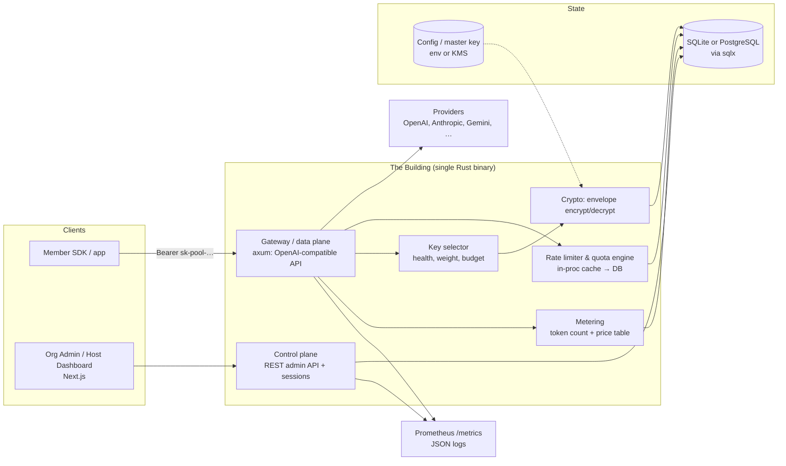

# Tributary — Complete Specification

| | |
|---|---|
| **Project** | **Tributary** — AI token pools · *"Small streams. Pooled power."* |
| **Version** | 0.3 — open questions resolved (D20–D26); lifecycle docs added |
| **Date** | 2026-10-14 (v0.1: 2026-10-13) |
| **Author** | Tran Dinh Hong Phat — Project founder (solo, CS student, Vietnam) + AI co-designer |
| **License** | FSL-1.1-ALv2 (SPDX; Future License: Apache-2.0 after 2 years) |
| **Status** | Decisions D1–D30 locked (Appendix A). Dev lifecycle: AGENTS.md (workflow), PLAN.md (status/log), AUDIT.md (security findings) |
| **One-liner** | Self-hostable AI token pools — govern your org's AI usage with per-member keys, quotas, and leak detection; or deposit surplus credits into a Solana-settled marketplace. |

---

## 1. Vision

Premium AI capacity is bought monthly and wasted monthly. Most plans and prepaid
API credits go partially unused; most students and small teams cannot afford
their own. **Tributary** is an open-source platform that turns surplus AI
capacity into shared, governed, rentable pools — packaged as simply as Docker
packaged containers:

> *Spin up a pool, hand out keys, meter the usage, settle the bill.*

Two products, one engine:

1. **Org Pools (V1, revenue engine)** — organizations fund isolated pools with
   their own AI credits and govern how members consume them.
2. **Root Pool (V2+, network moonshot)** — a marketplace where depositors
   contribute surplus API credits, earn pro-rata yield, and renters buy cheap
   AI access; settled transparently, eventually on Solana.

**Business posture:** open-core, self-host-first, built to earn revenue and
serve industry. If it fails commercially it remains a flagship Rust/Solana
portfolio project. It must fail upward.

**Elevator paragraph (README/landing):** Tributary turns surplus AI capacity
into shared, governed pools — packaged as simply as Docker packaged containers.
Organizations run private pools funded by their own provider keys: members get
per-user keys, budgets, rate limits, and leak detection behind one
OpenAI-compatible endpoint. Leftover credits can flow into the root pool — a
marketplace where depositors earn pro-rata yield and renters pay less for
metered AI access, with settlement moving on-chain to Solana as the network
grows. One binary, one database, one Docker command.

---

## 2. Glossary — the building metaphor

The project's shared language, used throughout this spec:

| Building world | Platform concept |
|---|---|
| Building | A deployed instance of the gateway (self-hosted or hosted) |
| Host / landlord | The operator running the instance |
| Apartment | A **pool** — an isolated, governable unit of AI credit |
| Renting out | Granting access to a pool with quota, term, and limits |
| Keys to the apartment | Pool API keys issued to members (provider keys never visible) |
| Electricity & water | Underlying AI capacity: provider API keys/credits |
| Electricity meter | Per-pool/per-member usage metering |
| Walls | Hard isolation: spend caps, quotas, rate limits |
| Tenant's family | Members invited into an org pool, with sub-limits |
| House rules | Model allowlists, content policy, audit logging |
| Furnished vs. empty | Host-funded pools vs. BYOK (bring-your-own-key) |
| Subletting | Nested pools (member carves quota into sub-allocations) |
| Owner-occupied floor | **Org Pool** — org supplies its own electricity |
| Rental apartments | **Root Pool** — depositors' electricity, renters pay |

---

## 3. Product surface

### 3.1 Org Pools (V1 — "owner-occupied floors")

**Who:** companies, university clubs, communities, friend groups.
**What they get:**

- An isolated pool they fund with **their own** provider API keys (BYOK).
- Per-member keys (`sk-pool-…`) — members never see provider keys.
- Budgets & quotas per member (daily/monthly token or currency caps).
- Rate limiting (requests/minute, tokens/minute) per member and per pool.
- Model allowlists ("only gpt-4o-mini and claude-haiku for interns").
- Usage dashboards: per member, per model, per day; cost attribution.
- Audit log of admin actions and anomalous events.
- OpenAI-compatible endpoint: members point existing SDKs at the pool URL.

**Leak prevention** (the differentiating wedge — see §9): stop and detect
members sharing their pool key with outsiders.

**Why orgs buy:** central procurement, no employee-owned keys, spend visibility,
compliance trail. Competitors (LiteLLM, Portkey, Helicone) sell the gateway;
almost none lead with credential-abuse prevention.

### 3.2 Root Pool (V2 — "rental apartments")

**Supply side — depositors:** contribute API credits (purchased, pay-as-you-go
keys — **never** subscription logins, see §4). Each contribution mints **shares**
proportional to contributed capacity (LP-token model). Depositors earn pro-rata
revenue as renters consume. Depositors may withdraw their stake.

**Demand side — renters:** students, small teams, indie hackers buy usage at
below-retail prices, throttled by rate limits. Prepaid balance, pay-per-token.

**Platform:** takes a spread (operator fee %) on every rental. Aggregates many
small surpluses into reliable supply; routes each request to a healthy
depositor key; meters everything; settles pro-rata by share.

### 3.3 The bridge (V3 — flywheel)

Org pools accumulate funded-but-unused balance at period end. Orgs may
(optionally, compliance-permitting) sweep surplus into the root pool and earn
yield. **Org service = supply funnel for the marketplace.** This is optional,
per-org, off by default.

---

## 4. Guardrails & non-negotiables

1. **No subscription harvesting.** Deposits are API credits/keys only — never
   personal plan logins (ChatGPT Plus, Claude Pro, etc.). Reselling consumer
   subscriptions violates provider ToS, gets accounts banned, wipes depositor
   stakes, and requires brittle browser automation. **Path B only.**
2. **Depositor keys are consented.** Root-pool depositors explicitly agree
   their keys are used by strangers within configured limits.
3. **Not "trustless."** All marketing/docs describe *minimally trusted with
   verifiable accounting*. The chain settles payments; it cannot verify
   off-chain routing truth (see §10).
4. **No token sale.** The protocol is open source; no ICO/token launch. Shares
   are ledger claims, not investments sold to the public. (Regulatory posture;
   revisit with counsel before V2 public launch.)
5. **Chain-optional UX.** Renters and org members never need a wallet in V1/V2.
   On-chain settlement is an operator/back-end concern.

---

## 5. System architecture

**Request lifecycle (member → provider):**

1. `POST /v1/chat/completions` with `Authorization: Bearer sk-pool-…`.
2. Key lookup (hashed) → resolve member, pool, rules. Reject if revoked/expired.
3. Rate-limit & budget check: in-process counter cache (1–5s TTL), authoritative
   row in DB. Over budget → `429` with reset hint.
4. Key selection among the pool's healthy provider keys (weighted, respecting
   remaining upstream quota, least-recently-used tiebreak).
5. Decrypt provider key (envelope), forward request, **stream response back**
   (SSE passthrough), count tokens from the stream.
6. Price the call from the model price table; append `usage_event`; update
   counters async (write-behind, flush ≤1s).
7. Record provider-key health signals (429/5xx → cooldown backoff).

**Latency budget:** added overhead target < 50 ms p95 per non-streaming request
excluding provider time; streaming first-byte overhead < 20 ms.

---

## 6. Data model (core)

| Table | Purpose / key columns |
|---|---|
| `organizations` | id, name, slug, settings(json), created_at |
| `users` | id, email, password_hash(argon2), role (host_admin / org_admin / member), org_id? |
| `pools` | id, org_id, name, kind (`org` \| `root`), model_allowlist(json), status, currency |
| `provider_keys` | id, pool_id, provider, base_url, ciphertext, key_prefix(**** last4), weight, health, status |
| `pool_keys` | id, pool_id, user_id, kind (always `live` since D31), key_hash, key_prefix, scopes, limits(json), expires_at, last_used_at, status |
| `quota_rules` | id, subject (pool_key/user/pool), period (minute/hour/day/month), limit_tokens, limit_requests, limit_cost |
| `usage_events` | id, ts, pool_id, pool_key_id, user_id, provider_key_id, model, prompt_tokens, completion_tokens, cost_micros, latency_ms, status |
| `usage_rollups` | period, pool_id, user_id, model → totals (hourly/daily) |
| `chart_of_accounts` | code (enum), account_type (asset/liability/equity/revenue/expense), definition, allowed counterparties — normative seed, versioned in repo; books kept from platform-operator perspective |
| `ledger_accounts` | id, code → chart_of_accounts, owner_kind (renter/depositor/org/operator), owner_id, currency — no freeform names |
| `ledger_entries` | txn_id, template_code, account_id, amount (int micro-units), direction (debit/credit), ref, ts — append-only; legs valid only via posting-rule templates |
| `audit_log` | actor, action, target, before/after(json), ip, ts |
| `ip_allowlists` | pool_key_id, cidr, note |

Provider keys: ciphertext only; never logged; UI shows prefix + last 4 only.
Price table: `model_prices` (model, provider, in_per_1k, out_per_1k, refreshed).

---

## 7. API surface

**Data plane (OpenAI-compatible):**
- `POST /v1/chat/completions` (streaming & non-streaming)
- `GET /v1/models` (filtered by pool allowlist)
- Later: `/v1/embeddings`, `/v1/completions`

**Control plane (REST, session or service token):**
- `/api/v1/orgs`, `/api/v1/pools`, `/api/v1/pools/{id}/keys`,
  `/api/v1/pools/{id}/provider-keys`, `/api/v1/members`, `/api/v1/usage`,
  `/api/v1/audit`, `/api/v1/quota-rules`
- Auth: session cookie (dashboard) — argon2 + secure HttpOnly; API: bearer
  service keys with scopes. SSO/SAML arrives only in the paid tier (M6+).

**Versioning:** path-versioned; OpenAI surface tracks upstream shapes.

---

## 8. Security & key custody

- **Envelope encryption:** master key from env/KMS (32 bytes); per-provider-key
  random data key; XChaCha20-Poly1305 (libsodium or audited pure-Rust
  equivalent — implementation: RustCrypto `chacha20poly1305`, D30). Master key
  never in DB.
- **At rest:** SQLite file or PG volume is not enough to steal keys.
- **In transit:** TLS terminates at the deployment edge (reverse proxy in
  compose).
- **Key display:** prefix + last-4 only, everywhere, forever.
- **Secrets hygiene:** no secrets in logs/tracing; `cargo-deny` + secret
  scanning in CI.
- **Threat model (V1):** curious member, leaked DB dump, rogue org admin
  (audit-logged), outsider with a stolen pool key (§9).
- **Canary tokens:** REMOVED post-M4 founder testing (D31) — low-yield
  tripwires; detection now rests on quota caps, impossible travel, and the
  purpose classifier (§9).

## 9. Leak prevention (the wedge)

Honest scope: a determined insider can always proxy their own traffic. Goal =
**detect + attribute + cap damage**, never "impossible."

**Free tier (M4):**
- Per-user keys (baseline — kills casual sharing)
- Per-user rate limits & quotas (blast-radius cap)
- IP/CIDR allowlists per key
- Key expiry & rotation; instant revocation
- Concurrent-connection limits; impossible-travel IP checks (simple)
- **Detection = quota caps (every cap firing writes an audit row) + impossible travel (geo-dormant) + classifier flags + distinct-IP concurrency alert (D32: same key from ≥2 distinct /24-collapsed source networks within a sliding window — default 5 min, org-tunable; ALERT-ONLY, never blocks).** Honey keys and canary model aliases were REMOVED post-M4 founder testing (2026-10-19, D31): low-yield tripwires
- **Purpose-alignment signals (BYOK classifier, D28):** org pastes a third-party classifier API key (e.g., Jev) in settings — **no key configured ⇒ feature stays dormant**; the settings page probes the API at save-time (validates key, shows served model — model id lives in org config, never code); **member disclosure banner mandatory** (covert scoring banned); scores feed the admin review queue; classifier key stored under existing envelope encryption; setup guide in docs
- **Purpose-alignment enforcement modes (D28, free tier):** *Alert* (default) — org-tunable threshold (recommended: flag below **0.5** alignment); admin reviews flags and manually blocks/unblocks/bans. *Auto-block* (explicit opt-in + warning) — recommended conservative threshold **0.15** alignment; **shadow mode first** (1–2 weeks showing "would have blocked N requests from M members" before going live); auto-block **only suspends the member's pool key pending review** (one-click unblock, full audit trail) — **never auto-bans people**; disclosure banner strengthens to "off-purpose requests may be blocked" when active

**Paid tier (M6+):**
- mTLS client certificates / device binding
- Behavioral anomaly detection (volume spikes, odd hours, new-ASN bursts) — covers leaks static rules miss
- Alert integrations (Slack/webhook/PagerDuty), audit export (CSV/JSON)
- SSO/SAML (SAML-OIDC bridge or vendor lib — build vs. buy at M6)

*(Split rationale: detection is the aha-moment/demo engine → free; response automation + coverage of the careful minority → paid anchor. Free-vs-paid is a packaging split — which code ships in the public core vs. the license-key gated build — not a runtime flag.)*

---

## 10. Trust model — operator accountability

The operator (host) holds provider keys, prepaid balances, and metering truth.
The chain cannot see off-chain routing; hence staged trust:

- **V1 — one trusted operator** (the founder): full audit logs; orgs' data in
  orgs' own infra (self-host) — the operator trust is *per-building*, and orgs
  can self-host so trust reduces to software audit.
- **V2 — bonded operators, verifiable books:** operators post periodic Merkle
  roots of usage/settlement state on-chain; challenge window lets anyone submit
  fraud proofs; proven fraud slashes the operator's bond to the victim.
- **V3 — competitive operator network:** on-chain registry (bond size, fee,
  uptime, integrity record = **track record**); renters/depositors choose like
  validators. Mitigate centralization drift via routing preferences for smaller
  operators / bond caps (design lever, revisit at V3).

---

## 11. Root pool economics (V2)

- **Deposit:** depositor contributes provider key(s) with credited capacity
  value → `ledger_entries` credit depositor account; mints **shares** =
  contributed / total pool (DB ledger first; SPL token in V2).
- **Consumption:** renter prepays (custodial balance) → each request debits
  renter, credits the pool revenue account.
- **Settlement (periodic):** revenue − operator fee = distributable; per
  depositor payout = distributable × share. DB double-entry ledger with clean
  `LedgerTrait` interface so the backend swaps to Solana without touching
  metering.
- **Fees:** operator fee % per transaction (parameter; target 5–10%).
- **Withdrawal:** depositor redeems shares for unpaid principal+earnings;
  rate-limited to preserve pool solvency (liquidity buffer parameter).
- **Key invalidation:** if a depositor key dies (revoked, exhausted), shares
  stop earning; principal marked down transparently; notification.

## 12. On-chain design (Solana, V2 milestones)

- **Program (Anchor/Rust):** share mint (SPL), deposit/withdraw, renter escrow
  (USDC), settlement from operator-posted Merkle roots, challenge window +
  fraud proof handler, operator bond + slash.
- **Chain does money; servers do speed.** No request ever routes on-chain.
- **Upgrade authority policy:** program deployed once; authority = Squads
  multisig (2-of-3); mandatory devnet soak; authority may be renounced
  (frozen) after the program is battle-tested. *(No EVM proxy patterns —
  Solana programs are natively upgradeable via upgrade authority.)*
- **Renter UX:** wallet-free. Custodial prepaid; chain settlement is back-end.

---

## 13. Tech stack (locked — Appendix A decision log)

| Layer | Decision | Notes |
|---|---|---|
| Gateway / data plane | **Rust** — axum + tokio | Career synergy with Solana; one heavy language |
| Control plane | Same binary (modular monolith) | Split only if forced |
| Database | **SQLite (single-container) + PostgreSQL (compose)** via sqlx | No DB-specific SQL in hot path |
| Cache / rate limits | In-process TTL cache → DB; Redis at scale milestone | Zero extra containers for installers |
| Auth | Built-in: argon2, session cookies, scoped API keys | SSO/SAML = paid tier |
| Frontend | **Next.js (App Router) + TS + Tailwind + shadcn/ui** | pnpm workspace |
| Repo | Monorepo: cargo workspace + pnpm workspace; GitHub Actions | |
| Key vault | App-level envelope encryption, XChaCha20-Poly1305 (RustCrypto, D30) | No Vault dependency |
| Metering store | `usage_events` in main DB + rollups; ClickHouse only if needed | |
| Observability | Baked-in minimal: Prometheus `/metrics`, health, JSON logs (tracing) | Grafana optional in compose |
| CI/CD | GitHub Actions: fmt/clippy/test (SQLite+PG via testcontainers)/pnpm build/cargo-deny; tag → multi-arch image → GHCR | Free on public repo |
| License | **FSL-1.1-ALv2** (SPDX; was informally "FSL-1.1-Apache-2.0" — corrected per AUDIT A-001) | Internal use free; no competing service; → Apache-2.0 in 2y |
| Payments | **Manual invoices (pilots) → Polar** (~4–5%, VN-verified MoR) | Stripe N/A for VN sellers |
| Monetization | Open-core: self-host free; paid = mTLS, anomaly, SSO, support | Hosted SaaS deferred |
| On-chain (V2) | Anchor on Solana; upgrade authority → Squads multisig → optional freeze | |

**Assumed defaults:** OpenAI-compatible API is table stakes; VPS deploy target
for any hosted demo (Hetzner-class, student budget); English docs first.

---

## 14. Milestones

### Milestone tracker

*Agents: tick the box on completion and append `— implemented at <commit-shorthand> <paths>, <date>`.*

- [x] **M0** — monorepo scaffold + CI skeleton — implemented at b000c42 `Cargo.toml` `crates/` `pnpm-workspace.yaml` `apps/dashboard/` `.github/workflows/ci.yml` `deny.toml` `LICENSE` `README.md` `.gitignore`, 2026-10-14
- [x] **M1** — gateway core: proxy, pool keys, streaming, metering — implemented at 2e9359e `migrations/` `crates/gateway/` `.github/workflows/ci.yml` `scripts/mock_openai.py`, 2026-10-15
- [x] **M2** — orgs, pools, provider keys (encrypted), quota/rate engine — implemented at cd5f97e (feat chain 8207e38→2fead3d) `migrations/` `crates/{common,crypto,control,gateway}/` `AGENTS.md`, 2026-10-17
- [x] **M3** — dashboards + audit log — implemented at 9d2ec2f→ba9ca28 `migrations/0006_audit_log_login_throttle.sql` `crates/{control,gateway}/` `apps/dashboard/` `.github/workflows/ci.yml`, 2026-10-17
- [x] **M4** — leak prevention free tier (+ BYOK purpose classifier + auto-block; canaries added then REMOVED by founder-tested decision D31) — implemented at 8613fab/4b2cea6/287b29d/215fdb4 (migrations/0007 + crates/{common,control,gateway} + apps/dashboard + scripts/manual_journey_m4.py), 2026-10-18; amended done-when satisfied at 210d1e8 (migrations/0008 + crates/{control,gateway} + apps/dashboard + scripts/manual_journey_m4.py + m4_journeys.rs j5), 2026-10-19; closed — implemented at 38caee5, 2026-10-22
- [x] **M5** — hardening + public packaging (docs site/landing/hosted demo descoped to M5.5 per D35) — implemented at f40b99c→66a1fe6→a09a9ad (hardening batches 1–3: A-019/A-020/A-021/A-022b/c/A-026/A-028 + migrations/0012–0014 + m5_journeys/m5_a026_gates), 72461b7 (/healthz), dd71729 (packaging: Dockerfile/compose/entrypoint + dashboard static export served by the binary), f7cae37 (J7 SDK contract + CI), 4f73c81 (J6 Playwright), f924d05 (public scrub), a1f4d39 (full-history jewel rewrite + force-push; v0.1.0 → GHCR), 5e66ba6 (RUSTSEC ctutils fix, re-tagged v0.1.0), caa628b/a1db959 (README stranger-run findings), closed — founder stranger run PASSED at eb28da3, 2026-10-25
- [x] **M5.5** — landing + demo video + Tailscale rung + Gemini provider (D35/D36) — slice 1 (landing via Pages CI, Tailscale rung stranger-proofed by founder findings #1–#7, video script, journey A/B/C PASS) 4f563c0→594032e, 2026-10-26; slice 2 (Gemini, closes M5.5) d258b1f/0d0c712/9984f46/5367101 — `crates/gateway/tests/m55_gemini.rs` (J-A/B/C public-API journeys dual-DB: provisioning encrypted+masked, compat-endpoint serving with metering/IP-fingerprint parity, quota denial before upstream, D32 on Gemini-routed traffic), `scripts/contract_openai_sdk.py` (J-D: official Python+JS SDK legs vs a mock Gemini-compat upstream, Bearer-only tripwire), `apps/dashboard/app/org/pools/page.tsx` (provider select + provider column), `README.md`/`deploy/README.md`/`deploy/.env.example` (provider paragraph, model-ID verify curl + VERIFIED slot, rate-limit honesty), `landing/index.html` (hero line), `docs/founder-journey-m55-slice2.md` (J-E real-key script + REAL-CONSUMER appendix), demo stack re-staged collision-proof @8112 + usage-history parity re-seeded, 2026-10-27. No gateway-code change needed: routing was already base_url + Bearer (provider-agnostic by construction — proven, not assumed). **Residue until real: demo video records ~2026-11-12; README link lands same day** (director's Nov-7 checkpoint chases it; stopwatch-number precedent)
- [ ] **M6** — pilot orgs (D20), adoption focus (V1 entirely free per D35; paid tier void)
- [x] **M7** — `LedgerTrait` + double-entry ledger — implemented at f0c25ca→8bbee09 (migrations/0015_ledger.sql + guards in crates/common/src/db.rs; crates/ledger/{src/{money,chart,posting,ledger,error}.rs,tests/{harness,append_only,journey,properties,alarms}}; deploy/README.md ledger boundary; SPEC D38 same-commit; dual-DB 172/172 incl. 16 new tests, red-first burglar alarms), 2026-10-28
- [ ] **M8** — Solana program: shares, escrow *(code complete + 16/16 program tests, workspace 189 green, fmt/clippy clean — implemented in `programs/pool/` + `scripts/devnet-soak/` + `scripts/devnet_soak_m8.sh`, 2026-10-30; **devnet soak pending founder faucet funding** — resume: `bash scripts/devnet_soak_m8.sh`; checkbox ticks only when the done-when passes on devnet)*
- [ ] **M9** — depositor mode: multi-key routing, pro-rata
- [ ] **M10** — renter self-serve (Polar checkout)
- [ ] **M11** — Merkle settlement + challenge window + bonds
- [ ] **M12** — operator registry on-chain
- [ ] **M13** — multi-operator routing & discovery
- [ ] **M14** — track-record explorer, org-surplus bridge

### V1 — Gateway + Org Pools (revenue engine)

| M | Scope | Done when |
|---|---|---|
| **M0** | Monorepo scaffold (cargo + pnpm), CI skeleton, this SPEC committed | PR pipeline green on empty hello-world crates |
| **M1** | Gateway core: proxy 1 provider (OpenAI), pool keys, streaming passthrough, token counting, `usage_events` | `curl` chat via `sk-pool-…` key; usage row written; both DBs pass |
| **M2** | Orgs, members, pools, provider keys (encrypted), quota/rate engine, key health | Two pools isolated: one's quota never affects the other |
| **M3** | Dashboards (host + org admin + member usage), audit log | Org admin creates member + key + budget without CLI |
| **M4** | Leak prevention free tier: IP allowlist, expiry/rotation, per-user caps (audited on every 429), impossible-travel flag, purpose-alignment BYOK classifier (dormant without org key, member disclosure, Alert + Auto-block modes per D28), distinct-IP concurrency detector (D32), admin 4-eyes (D33). Honey keys + canary aliases removed post-testing (D31) | Off-purpose flag visible in admin queue when a classifier key is configured; quota cap demonstrated in audit log; D33 journey — sensitive action by admin A on admin B requires B-independent second approval, containment-with-alert passes solo and auto-flags |
| **M5** | **Hardening block first** (director rulings 2026-10-22 on A-019/A-020/A-021/A-022): trusted client IP — `TRIBUTARY_TRUSTED_PROXIES` list, XFF parsed only from trusted proxies taking the rightmost untrusted hop, no proxy ⇒ socket addr (A-019); quota reserve→settle→release — atomic conditional reservation before upstream, settle at response end, release on error/cancel, TTL sweep for crashes (A-020); D32 flag dedupe via partial unique index, migration 0012 (A-021); D33 no-bypass — sensitive fields on direct endpoints 403 approval-required once org has ≥2 admins, enforced as the A-026 **class rule** (any admin-target action; pool disable by any mechanism; non-containment provider-key revoke) (A-022b+A-026); `AuthedKey` kind check (A-022c); classifier approvals bind to a **config epoch** — a stale (epoch-bumped) approval 409s and arms nothing (A-028). Then packaging: one-command compose + single-container SQLite image, GHCR releases, docs site, landing page, **OpenAI-SDK contract tests in CI (official Python + JS SDKs — activated here per director ruling 2026-10-15, deferred from M1)**; docs site + landing page + hosted demo descoped to M5.5 (D35 — demo becomes a recorded video over a private network; no servers, no domains) | Stranger deploys in <10 min from README; hardening proofs — spoofed XFF cannot pass a CIDR pin behind a trusted proxy, and a concurrent burst cannot exceed a cap by more than one request's estimate |
| **M5.5** | Landing page ("everything free" posture per D35) + demo video recorded over Tailscale/private network + Tailscale rung in the deploy docs ladder + **Gemini provider support** (OpenAI-compatible endpoint: config, docs, contract test — built at the GDG hackathon 2026-11-14; doubles as the honest Google-tech requirement for the entry, D36) | Landing + video linked from README; Gemini pool demoable live; zero recurring cost |
| **M6** | Pilot org onboarded; adoption focus — V1 entirely free per **D35**: no pricing derivation, no paid tier, no paid support offer; monetization deferred to V2 (operator fee, rule 8 band) | First real org daily-driving it |

### V2 — Root Pool (settlement layer)

| M | Scope |
|---|---|
| **M7** | `LedgerTrait` + double-entry ledger: normative chart-of-accounts (enum codes + typed columns + posting-rule templates, never freeform names); invariants as property tests (trial balance, normal balances, solvency); integer micro-units only — never floats; append-only enforced at DB level (no UPDATE/DELETE grants on `ledger_entries`); balances are cache, entries are truth (drift ⇒ alarm); budget→balance migration |
| **M8** | Solana program: share mint, deposit/withdraw, USDC escrow (devnet soak, multisig authority) |
| **M9** | Depositor mode: multi-key routing across depositor keys, pro-rata accounting |
| **M10** | Renter self-serve: Polar checkout → custodial balance; streaming payments optional |
| **M11** | Merkle settlement + challenge window; operator bond |

### V3 — Operator network

| M | Scope |
|---|---|
| **M12** | Operator registry on-chain (bond, fees, track record) |
| **M13** | Multi-operator routing & discovery |
| **M14** | Track-record explorer, anti-centralization routing preferences, org-surplus bridge |

**Milestone discipline:** every M ships deployable, demoable, tagged. No
"massive version" branches.

---

## 15. Non-functional requirements

- Single-container image < 100 MB; runs in 512 MB RAM (SQLite mode).
- p95 gateway overhead < 50 ms (non-streaming, excl. provider).
- Zero-downtime config reload for key rotation (SIGHUP / admin API).
- Backups: single SQLite file copy path documented; PG: standard dump jobs.
- Both DBs bit-identical behavior covered by one test suite (testcontainers).
- Docs: README quickstart ≤ 10 minutes to first proxied request.
- **Extensibility (feature growth, D29 companion principle):** the project will grow many features beyond today's set — new capabilities attach via trait seams + config (e.g., `LedgerTrait`, `ClassifierProvider`), never core surgery; migrations stay additive; provider/model identities live in config/DB, never code.

---

## 16. Risks & mitigations

| Risk | Severity | Mitigation |
|---|---|---|
| Provider ToS on key pooling | High | V1 is BYOK (orgs' own keys — normal gateway use); root pool = consented depositors; pursue reseller agreements as OpenRouter did |
| Root pool ≈ investment scheme (regulatory) | High | No token sale; open-source protocol; jurisdiction review before V2 public launch; custodial prepaid only |
| Trust asymmetry (operator holds truth) | Medium | Merkle settlement + challenges + bonds (V2); self-host option always available |
| Solo-founder scope death | Medium | Milestone discipline; ship-fast posture; libraries over NIH except core value |
| Competition (LiteLLM et al.) | Medium | Wedge = leak prevention; unique = pool economics + Solana settlement |
| Centralization drift in V3 | Low now | Bond caps / routing preferences designed at M12 |
| Crypto UX friction | Low in V1 | Chain-optional: wallets never required for members/renters |

## 17. Resolved decisions (formerly open questions)

| # | Question | Resolution |
|---|---|---|
| 1 | Name/branding | **Tributary** (D19) — GitHub repo claimed (`Phat1911/Tributary`); still to claim before M5: crates.io crate name, `tributary.dev`/`.ai` |
| 2 | First pilot orgs | Pilot outreach plan exists (D20); identities and terms private. Founder drafts outreach at M5. |
| 3 | Pricing | **PROVISIONAL (D27)** — pilots via manual invoice; root-pool operator fee stays inside the 5–10% band (§11). **Final pricing is derived at M6 implementation time** from actual delivery cost per org + pilot willingness-to-pay + competitor scan (D27); tier candidates re-derived under D29's cost-mirror rule. |
| 4 | Provider priority | D22: OpenAI (M1) → Anthropic → Gemini native adapters; **OpenRouter-as-upstream immediately after** (one OpenAI-dialect adapter → 100+ models); vLLM/Ollama self-host upstreams arrive free via the same dialect. |
| 5 | Model price table | D23: import script against LiteLLM's community-maintained `model_prices_and_context_window.json` + repo-owned `price_overrides.json` for corrections; refreshed per release; the price used is snapshotted into `usage_events` for auditability. |
| 6 | Individual renter identity | D24: custodial prepaid only, **hard balance cap $50** initially + manual AML red-flag review; KYC-lite deferred to V2 public-launch legal review; caps raised case-by-case. |
| 7 | Hosted demo | D25: one Hetzner CX22 (~€4/mo) deployed **at M5**, SQLite single-container with seeded demo data, nightly reset; explicitly demo-only — not production SaaS. |

---

## Appendix A — Decision log (design interview, 2026-10-13)

| # | Decision | Choice |
|---|---|---|
| D1 | Team | Solo founder |
| D2 | Existing skills | Rust, TypeScript/JS, Python |
| D3 | Gateway language | Rust (axum) |
| D4 | Database shape | SQLite + Postgres dual |
| D5 | Frontend | Next.js + Tailwind + shadcn/ui |
| D6 | V1 priority | Ship to pilot orgs fast |
| D7 | Monetization | Self-host + paid features (open-core) |
| D8 | Auth | Built-in lightweight |
| D9 | Rate-limit hot path | Postgres + in-process cache |
| D10 | Payments | Manual invoices → Polar (Vietnam-verified) |
| D11 | License | FSL-1.1-ALv2 (SPDX id corrected per AUDIT A-001; informally "FSL-1.1-Apache-2.0") |
| D12 | Observability | Baked-in minimal |
| D13 | Program upgrades | Solana upgrade authority → multisig → optional freeze (no EVM proxies) |
| D14 | CI/CD | GitHub Actions from M0; GHCR releases from M5 |
| D15 | Roadmap shape | Milestones per version; no monolith versions |
| D16 | Spec artifact | This file, SPEC.md |
| D17 | Canary tiering (post-spec amendment) — **SUPERSEDED by D31** | Detection free (honey keys, canary aliases, email alert, manual revoke); response automation + anomaly coverage paid |
| D18 | Ledger semantics (post-spec amendment) | Machine-enforced, not name-based: enum account codes + typed columns (account_type/owner_kind/owner_id) + normative chart-of-accounts seed + posting-rule templates; invariants as property tests |
| D19 | Project name (2026-10-14) | **Tributary** — tagline "Small streams. Pooled power."; collision scan clean (only an unrelated water-tech startup); claim GitHub org / crates.io / domain before M5 |
| D20 | Pilot orgs (2026-10-14) | Pilot outreach plan exists; identities and terms private |
| D21 | Pricing (2026-10-14) | Pilots: manual invoices. Self-serve paid tier: structure derived at M6; root-pool operator fee stays inside the 5–10% band (rule 8) |
| D22 | Provider priority (2026-10-14) | OpenAI → Anthropic → Gemini; OpenRouter-as-upstream adapter next; vLLM/Ollama via OpenAI dialect |
| D23 | Model price table (2026-10-14) | Import LiteLLM community JSON + repo-owned `price_overrides.json`; snapshot price into `usage_events` |
| D24 | Renter identity (2026-10-14) | Custodial prepaid, $50 hard cap, manual AML red flags; KYC-lite deferred to V2 legal review |
| D25 | Hosted demo (2026-10-14) | Hetzner CX22 at M5; seeded SQLite, nightly reset; demo-only |
| D26 | Dev lifecycle (2026-10-14) | AGENTS.md (conventions/rules/workflow), PLAN.md (status + milestone log + fast-jump), AUDIT.md (security findings); SPEC §14 milestone checkboxes ticked with implementation location |
| D27 | Pricing provisional (2026-10-14, founder) | Current pricing figures are placeholders, not commitments; final pricing set at M6 implementation from actual delivery-cost data + pilot willingness-to-pay + competitor scan; regional pricing remains an open option |
| D28 | Purpose-alignment signals (2026-10-15, founder-directed; amended same day) | **Free tier (M4), BYOK-only:** org supplies third-party classifier API key (e.g., Jev) via settings; no key ⇒ feature dormant; member disclosure banner mandatory; key under envelope encryption; `ClassifierProvider` adapter with churn defenses — raw HTTP version-pinned (no vendor SDKs), save-time key+model probe (model id in org config, never code), fixture contract tests, weekly live smoke job in CI, tolerant parsing, fail-open auxiliary path. **Enforcement modes (free per D29 cost-mirror rule):** Alert (default, threshold rec. 0.5 alignment, manual block/ban/unblock) and Auto-block (opt-in + warning, threshold rec. 0.15, shadow mode 1–2 weeks first, suspends pool key pending review only — never auto-bans; stronger member disclosure when active) |
| D29 | Paywall mirrors cost (2026-10-15, founder principle) | Gate a feature behind the paid tier ONLY when it carries real per-org cost to us — hosted/managed infra, third-party licenses we must buy, heavy support load. Code shipping in the self-hosted binary defaults to **free** (runs on the org's machine, $0 marginal cost). Existing tier assignments (D17 canary response automation; D21 mTLS/anomaly/SSO) re-derived at M6 alongside D27; SSO stays paid only if we license a vendor component. Durable paid anchors now: support + genuinely costed integrations; **hosted/managed stays deferred** (original trigger: ≥3 pilot orgs asking). Goal: minimize client price — adoption first; until then this rule governs. |
| D30 | Crypto implementation (2026-10-17, director ruling at M2) | Envelope encryption uses RustCrypto `chacha20poly1305` (XChaCha20Poly1305, pure Rust) instead of libsodium bindings — no C toolchain in CI/Docker/multi-arch cross-compiles (D14), audited, zeroize-first-class. The spec invariant is the algorithm + envelope format + AD binding (table:id), not the library; crypto crate remains the seam (§15). |
| D31 | Canary removal (2026-10-19, director — founder-tested decision) | Honey keys + canary aliases removed post-M4 founder testing (2026-10-19): low-yield tripwires; rogue-admin handled by audit accountability (§8); raw-key export removed with them, shrinking attack surface. |
| D32 | Distinct-IP concurrency detector (2026-10-20, founder-directed) | Same pool key actively used from ≥2 distinct /24-collapsed (v6: /64) source IPs within a sliding window (default 5 min, org-tunable via `org_settings`) → review-queue flag + audit row + email alert. ALERT-ONLY, never blocks. Replaces the removed canary detection (D31) as the credential-sharing tripwire. Known blind spot: sequential sharing (hand the key over, never use simultaneously) stays invisible — travel/behavioral later. |
| D33 | Admin separation of duties (2026-10-21, founder-directed; shaped by director; deferral to M6 overruled by founder same day) | Four-eyes for admin power, containment stays fast. ROUTINE ops (own members/keys/budgets) = single admin + audit. SENSITIVE = **2 distinct admins** (actor + approver, never the same person): removing/demoting another admin, altering another admin's credentials (expiry, revoke), org-wide policy (purpose statement, auto-block config, pool deletion). Guard: the last remaining admin cannot be removed/demoted. EMERGENCY containment (suspend/revoke a key with a **linked system alert** — D32, classifier suspension) = any single admin, instantly, auto-flagged to the review queue; the audit row must link the alert ID — a solo suspension without a linked alert is a detectable policy violation. Single-admin orgs auto-pass with a logged marker (never deadlocks). **Implemented at M4** — deterministic access control is fully testable with a seeded 2-admin org; no real-multi-admin trigger needed. **Addendum (2026-10-22, A-022 rulings):** `delete_org` joins the SENSITIVE set (strictly more destructive than pool deletion). **NO-BYPASS rule:** once an org has ≥2 admins, every SENSITIVE action via any *direct* endpoint returns 403 approval-required — the approval flow is the only write path; a generic settings PUT must not last-writer-win its way past the gate (fix scheduled M5 hardening). **Addendum 2 (2026-10-22, A-026 rulings — class-based, kills bypass whack-a-mole):** admin keys/accounts are a protected CLASS — ANY action targeting another admin's key or account (issuance, quota, allowlist, expiry, revoke, rotate) is SENSITIVE; org-wide impact actions (pool disable by any mechanism incl. quota-0 side effects; non-containment provider-key revoke) join pool deletion in the SENSITIVE set; quota-0 on *members* stays routine; admin-target key mints are gated, not forbidden; containment exemption unchanged — alert-linked provider-key revocation stays solo + flagged. |
| D34 | *(recorded privately — marketing/ops doctrine; held by the director)* | — |
| D35 | V1 ships entirely free (2026-10-25, founder strategy) | **No paid tier, no paid support offer, no hosted anything in V1.** Deployment is client-owned (VPS / Tailscale / LAN) — Tributary's obligation ends at documentation, guides, and video. Monetization is a V2 matter (Solana root pool; operator fee stays within rule 8's 5–10% band). D25's hosted-VPS demo is amended to a **recorded video over a private network**; D19 domain claims deferred as optional. Supersedes the V1 pricing-derivation intent of D27/D29 (the cost-mirror doctrine survives for V2 decisions). M6's "≥1 pays" gate is void — V1 success = real orgs daily-driving it. |
| D36 | GDG DevFest MienTrung 2026 mini hackathon entry (2026-10-26, founder-directed) | Tributary V1 enters as a **pre-built project** per the organizers' rule (submit current state + next build direction); V2 (Solana settlement) and V3 (operator network) presented as **roadmap only — no V2 work during the event**. Google-tech requirement satisfied HONESTLY (founder ruling after rejecting a faked claim): a real **Gemini provider** integration (OpenAI-compatible endpoint) built at the hackathon as the visible work item, plus Antigravity as build environment. Team = founder + 1 teammate. Track: An ninh mạng (primary) / tiện ích doanh nghiệp (secondary). The M5.5 demo video doubles as Demo Day material. Deadline: register ≤ 2026-11-05; event 2026-11-14 (Đà Nẵng). |
| D37 | Gemini-compat field drops: bounded, negation-only (2026-10-27, director ruling relayed by the founder after a live bisect) | Google's OpenAI-compatible endpoint 400s on OpenAI's `store` field ("Unknown name 'store': Cannot find field") instead of ignoring it — proven live 2026-10-27: an agent client sent `store:false` unconditionally and a field-by-field auto-bisect returned "200 OK after dropping: ['store']" (sole offender in a 39KB payload). Ruling: the gateway MAY drop an **explicit per-provider-kind allowlist** of request fields, **negation-only** — `store:false` is dropped for gemini-labeled keys; a truthy `store` is NEVER dropped, its upstream 400 propagates as the honest signal. Budget **≤ 3 fields per kind, forever**; **no generic unknown-field stripping** (that is a converter — do-not-chase list). Keys labeled otherwise (openai, custom) forward **letter-for-letter**, pinned by a PERMANENT non-interference test. A compat affordance, not format conversion — same spirit as the existing `stream_options.include_usage` injection/strip. |
| D38 | M7 ships the preparation, never the conversion (2026-10-28, director ruling at M7 GO) | **M7 ships the preparation, never the conversion — chart, posting rules, schema land now; money-denominated balances are born only when real value enters (M10+). V1 budgets remain quotas (behavior control). Nothing mints balances from quotas.** Resolves the SPEC M7-row "budget→balance migration" ambiguity (recorded per workflow step 9, AUDIT A-030). Companion chart rulings from the same GO, both pinning rule 7: Σ payable = **custodial-cash debts only** (settled depositor earnings + renter prepaid; contributed principal rides in `claims.contributed` OUTSIDE the equation, governed by the §11 withdrawal liquidity buffer), and the operator fee credits **equity.operator** — the operator is the accounting entity and does not owe itself custordial debt. |

